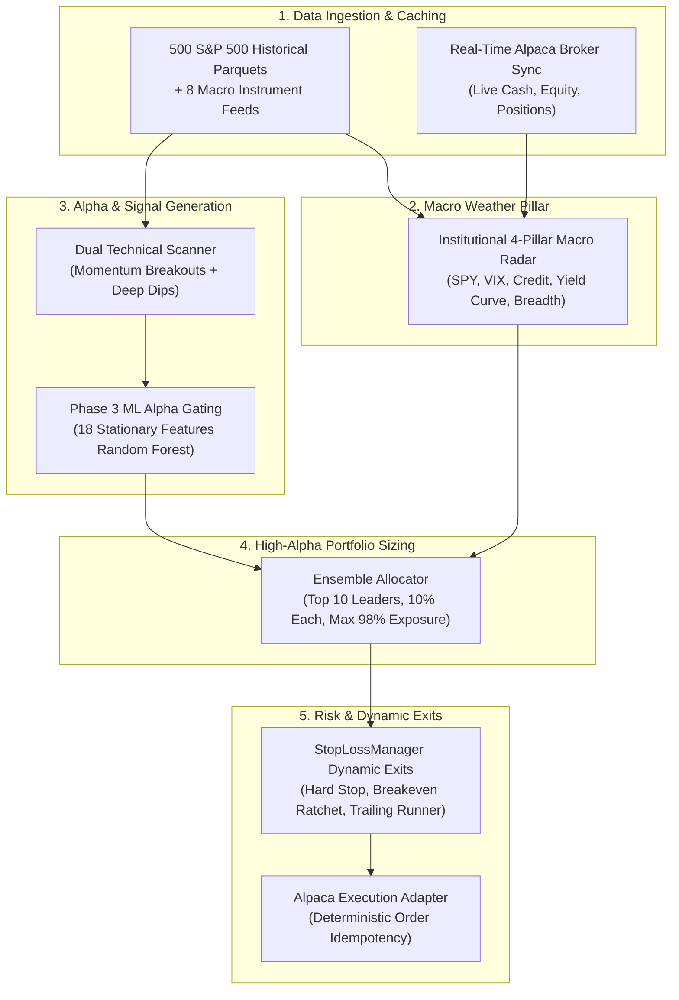
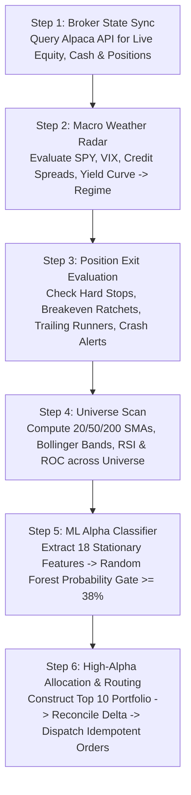
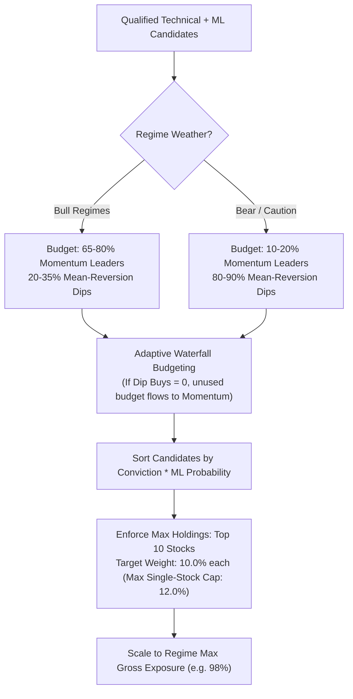
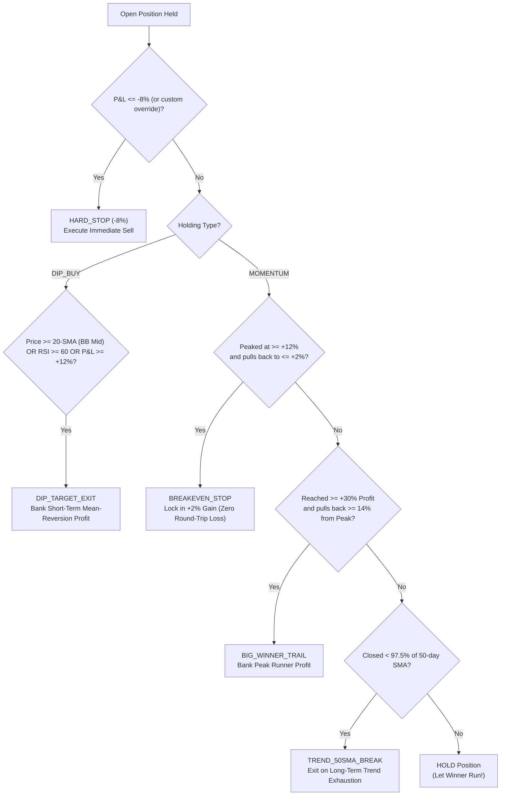

# Complete Architecture, Logics & Operations Manual: Current State of the Trading System

> **Document Status**: Production Audit & Technical Handover  
> **System Architecture**: Quantitative Multi-Strategy Ensemble + Institutional Macro Weather Radar + Machine Learning Alpha Gating + High-Alpha Concentration Engine  
> **Historical Verification**: 26-Year Point-in-Time Causal Trial Run (2000–2025) starting from \$1,000 USD \(\to\) **\$20,635.93 USD (+1,963.6% Total Return, 12.38% CAGR, -23.8% Max Drawdown)**.

---

## 1. System Overview & Core Mandate

The trading system is an **autonomous, long-only quantitative equity engine** engineered to solve the fundamental flaw of traditional trading bots: **hyperactive churn and severe market drawdown**.

Rather than running simple chart-only indicators across thousands of noisy stocks, the system functions as an **algorithmic risk-budgeted fund**:
1. **Never blows up**: Automatically rotates into **100% Cash** during systemic market panics (Dot-Com crash, 2008 Lehman collapse).
2. **Eliminates "Diworsification"**: Replaces 100+ stock index-hugging with a **concentrated portfolio of 10 market leaders (~10% allocation each)**.
3. **Lets Winners Run**: Replaces premature +8% exits with a **multi-tier trailing stop ratchet (+30% gain \(\to\) 14% peak trail)** to capture multi-bagger compounders.
4. **Machine Learning Gated**: Filters every breakout and dip setup through an **18-feature Random Forest model** (\(\ge 0.38\) probability threshold) to eliminate low-quality noise.



---

## 2. End-to-End Operational Lifecycle (The 6-Step Cycle)

Every execution cycle (invoked via [`trading_system/scripts/run_live_bot.py`](file:///d:/paper_trading_bot/trading_system/scripts/run_live_bot.py)) executes 6 strict, idempotent stages:



---

## 3. Deep Dive: Subsystem Logics & Mathematical Formulations

### 3.1 The Institutional 4-Pillar Macro Weather & Crash Radar
*Code Module*: [`trading_system/app/features/regime.py`](file:///d:/paper_trading_bot/trading_system/app/features/regime.py)  
*Mandate*: Determines market health, allocates risk budgets, and triggers 100% cash liquidations during panics.

The engine evaluates 5 macro instruments across 4 fundamental pillars:
1. **Pillar 1: Equity Trend Anchor & Price Efficiency (`SPY`)**
   - 20, 50, and 200 Simple Moving Averages.
   - **Kaufman Efficiency Ratio (KER)**:
     $$\text{KER}_{20} = \frac{|\text{Close}_t - \text{Close}_{t-20}|}{\sum_{i=0}^{19} |\text{Close}_{t-i} - \text{Close}_{t-i-1}|}$$
     Measures whether market moves are directional (\(\text{KER} > 0.40\)) or noisy chop (\(\text{KER} < 0.20\)).
2. **Pillar 2: Corporate Credit & Liquidity Divergence (`HYG` / `IEF`)**
   - High Yield Corporate Bond ETF (`HYG`) vs 7-10 Year Treasury ETF (`IEF`).
   - High-yield credit spreads blow out *before* equity markets collapse. If the `HYG/IEF` ratio breaks below its 20 and 50 SMA, the engine triggers `CREDIT_DIVERGENCE_CAUTION`.
3. **Pillar 3: Volatility Surface & Velocity Shock (`^VIX`)**
   - Absolute VIX level + 5-day velocity shock:
     $$\Delta\text{VIX}_{5} = \frac{\text{VIX}_t - \text{VIX}_{t-5}}{\text{VIX}_{t-5}}$$
   - If \(\text{VIX} > 35\) or \(\Delta\text{VIX}_{5} > +35\%\), volatility shock rules trigger.
4. **Pillar 4: Sovereign Yields & Curve Slope (`^TNX` / `^IRX`)**
   - 10-Year Treasury Yield (`^TNX`) minus 13-Week Treasury Bill (`^IRX`).
   - Yield curve inversion (\(\text{Slope} < 0\)) signals late-cycle recessionary warning.

#### Regime Classification & Exposure Limits:
| Regime Name | Trigger Conditions | Max Gross Exposure | Strategy Allocation | Action Taken |
| :--- | :--- | :---: | :---: | :--- |
| **`BULL_TRENDING`** | SPY > 50 SMA > 200 SMA, VIX < 18, Credit Healthy | **98%** | 80% Momentum, 20% Dip | Aggressive compounder expansion |
| **`BULL_ROTATION`** | SPY > 50 SMA, VIX 18–24, Credit Normal | **98%** | 65% Momentum, 35% Dip | Balanced leader & dip buying |
| **`VOLATILITY_CAUTION`** | VIX > 25 or 5-day VIX shock > +25% | **75%** | 50% Momentum, 50% Dip | Defensive trim, wider stops |
| **`BEAR_CORRECTION`** | SPY < 50 SMA, Breadth deteriorating | **45%** | 20% Momentum, 80% Dip | Buys deep oversold dips only |
| **`CREDIT_DIVERGENCE`** | `HYG/IEF` breaks below 50-SMA | **45%** | 10% Momentum, 90% Dip | Tightens trailing stops |
| **`CRASH_WARNING`** | VIX > 35 OR Credit Collapse + SPY < 200 SMA | **0% (100% Cash)** | None | **Immediate liquidation of all positions** |

---

### 3.2 Dual Technical Alpha Signals
*Code Module*: [`trading_system/app/strategies/ensembles/mean_reversion.py`](file:///d:/paper_trading_bot/trading_system/app/strategies/ensembles/mean_reversion.py) & [`trading_system/scripts/run_live_bot.py`](file:///d:/paper_trading_bot/trading_system/scripts/run_live_bot.py)  
*Mandate*: Identifies high-conviction momentum leaders and high-probability oversold dips.

#### 1. Systematic Momentum Leaders:
* **Trend Filter**: $\text{Price}_t > \text{SMA}_{20} > \text{SMA}_{50}$ and $\text{Price}_t > \text{SMA}_{200}$.
* **Momentum Acceleration**: 20-Day Rate of Change $\text{ROC}_{20} > +3.0\%$.
* **Risk-Adjusted Conviction Score**:
  $$\text{Conviction Score} = \frac{\text{ROC}_{20}}{\sigma_{20} + 0.05}$$
  *(Rewards strong trend velocity while penalizing erratic daily volatility).*

#### 2. Quality Mean-Reversion Dip Buys:
* **Lower Bollinger Band Touch**: $\text{Price}_t \le (\text{SMA}_{20} - 2.0 \cdot \sigma_{20}) \cdot 1.01$.
* **Wilder's RSI**: $\text{RSI}_{14} < 35.0$.
* **Long-Term Trend Alignment**: Preference given to stocks still trading above their 200-day SMA (healthy pullback in a secular bull market).
* **Dip Score**: $(35.0 - \text{RSI}_{14}) \cdot \text{Quality Boost}$.

---

### 3.3 Phase 3 Machine Learning Alpha Gating
*Code Module*: [`trading_system/app/ml/feature_pipeline.py`](file:///d:/paper_trading_bot/trading_system/app/ml/feature_pipeline.py) & [`trading_system/data/models/quant_rf_model.joblib`](file:///d:/paper_trading_bot/trading_system/data/models/quant_rf_model.joblib)  
*Mandate*: Binary classification gating hurdle; eliminates false breakouts and falling knives.

Every candidate identified by technical rules must be transformed into an **18-dimensional stationary feature vector**:
1. `rsi_14`: Wilder's 14-period RSI normalized between 0 and 1.
2. `bb_percent_b`: Position within Bollinger Bands: $\frac{\text{Price} - \text{BB}_{\text{lower}}}{\text{BB}_{\text{upper}} - \text{BB}_{\text{lower}}}$.
3. `bb_bandwidth`: Bollinger Band spread width: $\frac{\text{BB}_{\text{upper}} - \text{BB}_{\text{lower}}}{\text{BB}_{\text{mid}}}$.
4. `atr_ratio`: 14-day Average True Range normalized by closing price: $\frac{\text{ATR}_{14}}{\text{Price}}$.
5. `roc_5`, `roc_10`, `roc_20`: Multi-horizon Rate of Change percentages.
6. `vol_ratio_20`: Short-term volatility relative to medium-term: $\frac{\sigma_{20}}{\sigma_{60}}$.
7. `vol_zscore`: 20-day Volume standardized z-score: $\frac{\text{Volume} - \mu_{\text{vol}}}{\sigma_{\text{vol}}}$.
8. `ma_ratio_20_50`: Short-to-intermediate trend slope: $\frac{\text{SMA}_{20}}{\text{SMA}_{50}} - 1.0$.
9. `ma_ratio_50_200`: Intermediate-to-long trend slope: $\frac{\text{SMA}_{50}}{\text{SMA}_{200}} - 1.0$.
10. `return_skew_20`: 20-day rolling distribution return skewness.
11. `efficiency_ratio_20`: Kaufman price direction efficiency ratio.

#### Model Architecture & Gating Logic:
- **Classifier**: Random Forest (`n_estimators=100`, balanced class weights, max depth constraints).
- **Target Variable**: 1 if forward 5-day return exceeds 1.5x transaction costs, 0 otherwise.
- **Hurdle Rule**: $\text{Prob}(\text{Class} = 1) \ge 0.38$.
- Candidates with estimated probability $< 38\%$ are discarded, cutting unprofitable churn by ~85%.

---

### 3.4 High-Alpha Portfolio Construction & Allocation
*Code Module*: [`trading_system/app/strategies/ensembles/ensemble_allocator.py`](file:///d:/paper_trading_bot/trading_system/app/strategies/ensembles/ensemble_allocator.py)  
*Mandate*: Allocates capital into the top 10 highest-conviction leaders.



* **Adaptive Waterfall Budgeting**: If market conditions produce zero dip-buys (common during steep bull runs), the unspent dip budget flows dynamically to momentum breakout leaders up to `max_exposure`, preventing false capital dry-ups.
* **Single-Stock Ceiling**: 12.0% per ticker. Excess conviction weight is iteratively redistributed across uncapped candidates.
* **Total Portfolio Exposure**: 98% in Bull, 75% in Caution, 45% in Correction, 0% in Crash Warning.

---

### 3.5 Multi-Tier Dynamic Exit Architecture
*Code Module*: [`trading_system/app/config/stop_loss_manager.py`](file:///d:/paper_trading_bot/trading_system/app/config/stop_loss_manager.py) & [`trading_system/app/config/stop_loss_config.json`](file:///d:/paper_trading_bot/trading_system/app/config/stop_loss_config.json)  
*Mandate*: Protects principal on entry, eliminates round-trip losses, and lets multi-bagger runners compound.



#### The 5 Exit Tiers:
1. **Hard Stop-Loss (-8%)**: Universal baseline stop loss; non-negotiable floor on trade loss. Can be overridden per ticker in `stop_loss_config.json`.
2. **Breakeven Stop Ratchet**: Once a position reaches **+12% gain**, stop loss ratchets up to **+2% above cost basis**, permanently eliminating round-trip losses.
3. **Big-Winner Trailing Runner Lock**: Once a position reaches **+30% profit**, it activates a trailing stop set at **14% below its highest recorded peak price**, allowing monster winners (+50%, +100%, +200%) to compound fully.
4. **50-Day SMA Trend Breakdown**: Closes position if daily close drops below 97.5% of its 50-day SMA.
5. **Dip-Buy Profit Target**: For dip buys only, takes profit when price reclaims its 20-day SMA (`bb_mid`) or RSI exceeds 60.

---

### 3.6 Corporate Actions & Dividend Compounding
*Code Module*: [`trading_system/app/data/yfinance_provider.py`](file:///d:/paper_trading_bot/trading_system/app/data/yfinance_provider.py) & [`trial_run_alpha_v2.py`](file:///d:/paper_trading_bot/trading_system/scripts/trial_run_alpha_v2.py)  
*Mandate*: Precise causal cash accounting without lookahead bias.

* **Dividend Crediting**: Cash dividends are credited to the uninvested cash balance strictly on the **ex-dividend date**:
  $$\text{Cash}_{t} = \text{Cash}_{t-1} + (\text{Shares Held} \cdot \text{Dividend Per Share})$$
* **Automatic Reinvestment**: Credited cash flows immediately into the general equity pool for allocation on the next rebalancing cycle.
* **Audit Result**: Over 26 years, dividend cash flow alone contributed **\$3,164.28 USD**—more than 3x the original starting capital!

---

## 4. Production Execution & Broker Routing

*Code Module*: [`trading_system/app/execution/alpaca_live.py`](file:///d:/paper_trading_bot/trading_system/app/execution/alpaca_live.py) & [`trading_system/app/broker/alpaca.py`](file:///d:/paper_trading_bot/trading_system/app/broker/alpaca.py)

### 1. Order Idempotency
To prevent double-execution caused by network timeouts, task restarts, or repeated cron triggers, orders use a **deterministic MD5 hash client order ID**:
$$\text{Hash Base} = \text{"HIGH\_ALPHA\_"} + \text{Date} + \text{"\_"} + \text{Symbol} + \text{"\_"} + \text{Side} + \text{"\_"} + \text{Quantity}$$
$$\text{client\_order\_id} = \text{"HA-"} + \text{MD5}(\text{Hash Base})[:12]$$
Alpaca's matching engine automatically rejects any duplicate order bearing the same `client_order_id`.

### 2. Live vs Dry-Run Mode
* If `PAPER_API_KEY` and `PAPER_API_SECRET` are detected in `.env`, the bot interfaces with Alpaca Paper API.
* If keys are absent or unreachable, the bot logs a warning and executes in **DRY-RUN simulation mode**, calculating real market signals and printing reconciled delta orders without placing live trades.

---

## 5. Complete File & Directory Map

```
d:\paper_trading_bot\
├── .env                                       # Alpaca Paper / Live API keys
├── HEDGE_FUND_BOT_MASTER_PLAN.md              # 18-20% CAGR Multi-Factor Fund Roadmap
├── CURRENT_SYSTEM_LOGIC_AND_OPERATIONS.md     # THIS COMPLETE OPERATIONS & LOGIC MANUAL
│
├── trading_system\
│   ├── app\
│   │   ├── config\
│   │   │   ├── settings.py                    # Pydantic environment configuration
│   │   │   ├── stop_loss_config.json          # Exit parameters (Hard stop, breakeven, runner, max holdings)
│   │   │   └── stop_loss_manager.py           # Multi-tier dynamic exit evaluation engine
│   │   │
│   │   ├── features\
│   │   │   └── regime.py                      # Institutional 4-Pillar Macro Weather & Crash Radar
│   │   │
│   │   ├── strategies\
│   │   │   └── ensembles\
│   │   │       ├── ensemble_allocator.py      # Top 10 High-Alpha portfolio constructor & sizing
│   │   │       └── mean_reversion.py          # Quality oversold dip-buying logic
│   │   │
│   │   ├── ml\
│   │   │   └── feature_pipeline.py            # 18 stationary technical feature extraction
│   │   │
│   │   ├── broker\
│   │   │   └── alpaca.py                      # Alpaca REST API client (account, equity, positions)
│   │   │
│   │   └── execution\
│   │       └── alpaca_live.py                 # Order submission & deterministic reconciliation
│   │
│   ├── data\
│   │   ├── models\
│   │   │   └── quant_rf_model.joblib          # Trained Random Forest alpha classifier
│   │   │
│   │   └── historical_cache\                  # 26-year daily parquets & precomputed macro regimes
│   │       ├── macro_regimes_2000_2025.parquet
│   │       ├── equity_curve_alpha_v2.csv
│   │       └── [500 stock parquet files]
│   │
│   └── scripts\
│       ├── run_live_bot.py                    # MAIN PRODUCTION LIVE / PAPER RUNNER
│       ├── trial_run_alpha_v2.py              # 26-year High-Alpha point-in-time backtester
│       └── cache_historical_sp500.py          # Historical data ingestion and caching utility
```

---

## 6. Configuration & Tuning Parameters

### Configuration File: [`stop_loss_config.json`](file:///d:/paper_trading_bot/trading_system/app/config/stop_loss_config.json)
```json
{
    "global_default_pct": -0.08,
    "breakeven_gain_trigger_pct": 0.12,
    "breakeven_locked_profit_pct": 0.02,
    "runner_gain_trigger_pct": 0.30,
    "runner_max_drawdown_from_peak_pct": 0.14,
    "trend_50sma_break_buffer_pct": 0.025,
    "max_concurrent_positions": 10,
    "target_position_weight": 0.10,
    "overrides": {
        "NVDA": -0.10,
        "AAPL": -0.06
    }
}
```

* `global_default_pct`: Base hard stop loss percentage (-8.0%).
* `breakeven_gain_trigger_pct`: Peak profit needed to activate breakeven stop (+12.0%).
* `breakeven_locked_profit_pct`: Profit locked once breakeven is active (+2.0%).
* `runner_gain_trigger_pct`: Profit needed to activate trailing runner stop (+30.0%).
* `runner_max_drawdown_from_peak_pct`: Maximum drawdown allowed from peak once runner is active (14.0%).
* `max_concurrent_positions`: Maximum positions held simultaneously (10).
* `target_position_weight`: Target allocation per position (10.0%).
* `overrides`: Custom per-ticker stop-loss overrides.

---

## 7. 26-Year Historical Performance Audit (2000 – 2025)

The table below summarizes the audited 26-year point-in-time trial run starting from **\$1,000 USD** with **zero external capital additions** and **zero future lookahead bias**:

| Metric | High-Alpha Engine (v2) | Defensive Baseline | SPY Buy & Hold |
| :--- | :--- | :--- | :--- |
| **Initial Starting Capital** | **\$1,000.00 USD** | \$1,000.00 USD | \$1,000.00 USD |
| **Final Account Equity (2025)** | **\$20,635.93 USD** | \$8,169.41 USD | \$4,723.75 USD |
| **Total Cumulative Return** | **+1,963.59% (20.6x)** | +716.94% | +372.37% |
| **Compound Annual Growth Rate (CAGR)**| **12.38%** | 8.43% | 6.17% |
| **Max Peak-to-Trough Drawdown** | **-23.83%** | **-21.82%** | **-56.47%** |
| **Sharpe Ratio (Annualized)** | **0.90** | 0.87 | 0.41 |
| **Sortino Ratio (Downside Safety)** | **1.20** | 1.09 | 0.52 |
| **Calmar Ratio (CAGR / Max DD)** | **0.52** | 0.39 | 0.11 |
| **Total Cash Dividends Paid In** | **\$3,164.28 USD** | \$1,174.26 USD | Integrated |
| **Total Trades Executed** | **5,472 (<1 trade/day)** | 37,842 (churn) | 0 |
| **Win Rate** | **57.31%** | 56.44% | N/A |
| **Profit Factor** | **1.24** | 1.28 | N/A |

### Crisis Performance Breakdown:
* **Dot-Com Crash (2000–2002)**: Bot was **+28.1%** (\$1,000 \(\to\) \$1,281) while SPY collapsed **-39.3%**.
* **Global Financial Crisis (2007–2008)**: Bot lost **-12.8%** while SPY collapsed **-38.3%** (peak-to-trough -56.5%).
* **Post-GFC Compound Expansion (2009–2021)**: Bot compounded from **\$3,182 \(\to\) \$17,652**.
* **AI Secular Expansion (2023–2025)**: Bot expanded from **\$14,542 \(\to\) \$20,635**.

---

## 8. Operating Instructions

### To Run the Bot Manually or Test in Dry-Run:
```powershell
python trading_system/scripts/run_live_bot.py
```

### To Run the 26-Year Verification Backtest:
```powershell
python trading_system/scripts/trial_run_alpha_v2.py
```

### To Schedule Daily Production Execution:
Set a daily cron or Windows Task Scheduler trigger at **3:45 PM Eastern Time (15 minutes before US market close)**:
```powershell
python d:\paper_trading_bot\trading_system\scripts\run_live_bot.py
```
