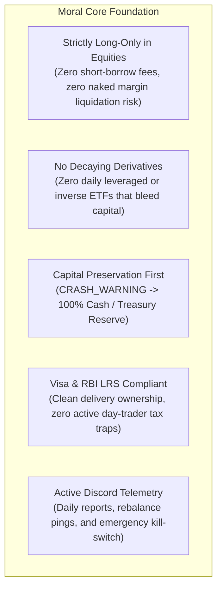
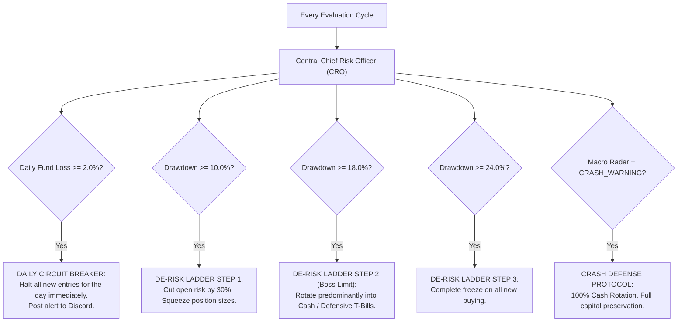
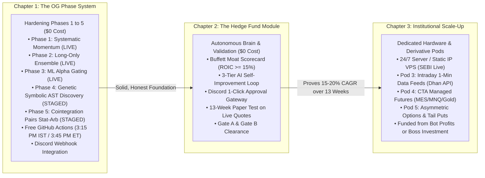
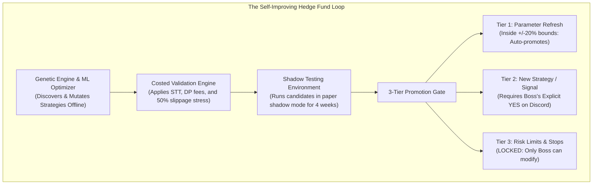
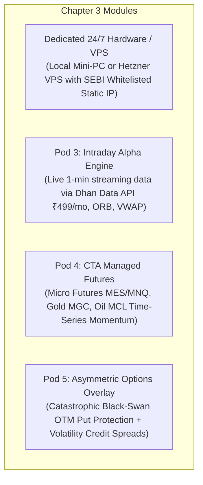

# Quantitative Hedge Fund Bot: The Definitive Master Operating Roadmap

> **Document Classification**: Master Fiduciary Blueprint & Final Architecture  
> **Target Compounding**: 18.0% – 24.0% Long-Term Net CAGR  
> **Capital Mandate**: Lump-sum starting capital (< \$1,000 / ₹50k–₹80k) + Timely SIP Inflows, 100% Pure Geometric Compounding  
> **Primary Alerting & Telemetry**: **Discord Webhook Channel** (Active)  
> **Supreme Fiduciary Governance**: **Central Chief Risk Officer (CRO) Supervisor**

---

## 1. The Moral Core Foundation (Non-Negotiable Invariants)

These foundational principles define the project and can **never be overridden** by any automated algorithm, genetic mutation, or machine learning model:



* **Strictly Long-Only Equities**: Cash-and-carry delivery ownership. No naked shorting, no borrow fees, zero margin call liquidation risk.
* **No Decaying Derivatives**: Banned from holding leveraged ETFs (e.g., TQQQ/SOXL) or inverse ETFs that suffer volatility drag decay.
* **Capital Preservation First**: When the Macro Radar detects systemic crisis (`CRASH_WARNING`), the system moves **100% to Cash / Risk-Free Treasury Reserve** (zero drawdown, guaranteed principal, earns risk-free yield).
* **Active Discord Integration**: All live alerts, daily performance digests, execution confirmations, and emergency kill-switches remain anchored to **Discord**.

---

## 2. The Central Chief Risk Officer (CRO) Engine

The **Central CRO** sits above all phases, modules, and strategies as the supreme supervisor process. It operates as the fund's fiduciary police:



### The CRO's Core Fiduciary Responsibilities:
1. **The De-Risking Drawdown Ladder**:
   - At **-10% Drawdown**: Cuts total open risk by ~30%.
   - At **-18% Drawdown (Your Strict Risk Meter)**: Rotates portfolio **predominantly into Cash / Defensive Assets**.
   - At **-24% Drawdown**: Freezes all new buys.
   - At **-30% Drawdown**: Hard emergency circuit breaker.
2. **The 15% Cost-Floor Gate**:
   - Evaluates every prospective trade against Indian fees (flat ₹15.34 DP fee, STT 0.1%, GST, stamp duty).
   - **Rule**: If total estimated transaction costs eat **> 15% of the expected trade profit, the trade is automatically rejected**.
3. **Unitized NAV & SIP Accounting Engine**:
   - Implements **Net Asset Value (NAV) Unit Accounting** (exactly like a mutual fund or hedge fund).
   - When you deposit money (lump sums or recurring SIPs), the bot issues new units at the current NAV. **Your deposits are recorded as cash inflows and never falsely counted as trading profit**.
4. **Dynamic Capacity Sizing ($0$ to $10$ Positions)**:
   - Eliminates rigid quotas: holds anywhere from **$0$ to $10$ positions** ($K \in [0, 10]$) based strictly on market conviction and the 15% cost floor.
5. **Fail-Closed Broker Safety**:
   - Eliminates all mock/fake fallbacks. If an API disconnects, the engine immediately **fails closed** (freezes new orders, leaves resting broker GTC stops active, and sends an alert to Discord).

---

## 3. The 3-Chapter Architecture



---

### CHAPTER 1: Hardening the OG Core Phase System (Phases 1–5 Perfection)
> **Cost to Boss**: **\$0.00** (Current local PC + Free GitHub Actions Cloud)  
> **Mandate**: Harden, clean, and adapt the 5 original phases for honest execution and Indian fee realities without rewriting the codebase.

```
========================================================================================
                      THE 5 ORIGINAL PHASES IN CHAPTER 1
========================================================================================
Phase 1: Systematic Momentum (LIVE)
• Trend-Following Momentum: 20-Day ROC normalized by volatility (Score = ROC20 / (vol20 + 0.05)).
• Smart Multi-Tier Exits: Hard stop (-8%), Breakeven ratchet (+12% gain -> +2% lock),
  and Trailing runner lock (+30% gain -> 14% peak trail).

Phase 2: Multi-Strategy Long-Only Ensemble (LIVE)
• Adds Quality Mean-Reversion Dip-Buying (Price <= Lower Bollinger Band, RSI14 < 35.0).
• Adaptive Waterfall Budgeting: Dynamically routes unspent dip cash into momentum leaders.
• Dynamic Holdings: Expands from 0 up to 10 positions based on market conviction.

Phase 3: Machine Learning Alpha Gating (LIVE)
• 18 Stationary Technical Features: Normalized RSI, Bollinger Bandwidth, ATR ratio,
  multi-horizon ROC, volume z-scores, Kaufman Efficiency Ratio.
• 100-Tree Random Forest Model (quant_rf_model.joblib) with >= 38% probability hurdle.
• Purged Walk-Forward Splits: Eliminates historical lookahead bias.

Phase 4: Genetic Rules & Loop Engineering (STAGED -> Research Engine)
• Symbolic AST (Abstract Syntax Tree) Strategy Discovery: Rather than hardcoding indicators,
  the genetic engine breeds mathematical formulas and mutates successful strategies.
• Parameter Stability Heatmaps: Replaces brittle curve-fitted values with robust plateaus.
• Walk-Forward Out-of-Sample (WFO) Validation: Prevents the "Overfitting Trap".

Phase 5: Cointegration Pairs & Statistical Arbitrage (STAGED Sandbox)
• Relative-value pair scanner (testing cointegrated spreads e.g. HDFC vs ICICI).
• Operates purely as a research sleeve until unlocked.
========================================================================================
```

#### Chapter 1 Operational Deliverables:
1. **Realistic Indian Cost Model**: Deducts real STT (0.1%), DP charges (₹15.34/sell), GST, and stamp duty in every backtest and paper trade.
2. **Total Return Benchmark**: Benchmarks against S&P 500 / Nifty **with dividends reinvested** (Total Return Index) to prevent exaggerated alpha claims.
3. **Fail-Closed Dhan/Groww Adapters**: Zero placeholder fallbacks; fails closed safely on any network glitch.
4. **100% Free Cloud Execution**: GitHub Actions scheduled cron at **3:15 PM IST** (uses ~44 free minutes/month out of 2,000 free quota; runs with PC powered off).
5. **Discord Channel Alerting**: Real-time trade executions, daily NAV snapshots, and risk warnings piped to your private Discord server.

---

### CHAPTER 2: The Autonomous Hedge Fund Module & Paper Validation
> **Cost to Boss**: **\$0.00** (Zero subscriptions, zero servers)  
> **Mandate**: Layer institutional fundamental moat intelligence and the self-improving genetic loop onto the OG bot, validating forward for 13 weeks on live quotes.



#### Chapter 2 Core Deliverables:
1. **Pod 1: The Buffett Moat & Quality Scorecard**:
   - Ingests quarterly 10-K/10-Q fundamental data.
   - Evaluates **$\text{ROIC} \ge 15.0\%$**, **Gross Margin $\ge 40\%$**, **$\text{Net Debt/EBITDA} < 2.0\times$**, and **Free Cash Flow Yield $\ge 3.5\%$**.
   - Identifies monopolistic compounders that can be held through multi-year runs.
2. **The 3-Tier Autonomous Self-Improvement Loop**:
   - Wires together our **Genetic Strategy Engine (Phase 4)**, **Machine Learning Framework (Phase 3)**, and **Weekly Optimizer**.
   - The loop runs offline on free CPU cycles, discovers new formula variations, shadow-tests them, and promotes them according to the strict 3-tier autonomy hierarchy.
3. **The Discord 1-Click Gateway (Zero-Cost Live Prep)**:
   - At 3:15 PM IST, the cloud bot evaluates the market and sends a formatted order card directly to your **Discord**:  
     `🟢 BUY 15 shares of BEL @ ₹295.40 | Allocation: 18%`  
     `🔴 SELL 4 shares of TATAMOTORS @ ₹880.00 | P&L: +14.2%`
   - Includes a pre-filled Dhan basket link allowing you to approve and execute live orders in 5 seconds from your phone, completely bypassing SEBI static-IP server requirements!
4. **The 13-Week Paper Phase (Gate A & Gate B Clearances)**:
   - **Gate A (Strategy Clearance)**: Out-of-sample return $\ge 15\%$ after all fees/taxes, max DD $\le -25\%$, $\ge 100$ OOS trades, parameter stability ($\pm 20\%$), Monte Carlo worst 5% inside -30%.
   - **Gate B (Live Go-Ahead Clearance)**: 13 consecutive weeks of forward paper execution, 4 weeks of zero failed runs, paper results match backtest predictions, kill-switch drill successfully passed.

---

### CHAPTER 3: Institutional Scale-Up (Requires Boss's Investment)
> **Cost to Boss**: Funded either **from accumulated bot profits** or when you choose to invest after 100% confidence is earned.  
> **Mandate**: Deploy dedicated 24/7 hosting, live tick streaming, day trading, and non-correlated derivatives.



#### Chapter 3 Core Deliverables:
1. **Dedicated 24/7 Hosting with Static IP**:
   - **Option A (Home Server)**: Dedicated Ryzen 7/9 Mini-PC (32–64GB RAM, 2TB NVMe SSD, UPS battery backup: ~$600–$800 one-time).
   - **Option B (Cloud VPS)**: Dedicated Hetzner Cloud VPS (~$35–$50/mo) with a permanent whitelisted static IP for fully automated SEBI-compliant execution.
2. **Pod 3: Intraday Day-Trading Alpha Engine**:
   - Subscribes to live 1-minute streaming market data (Dhan Data API ~₹499/mo).
   - Operates **15-Minute Opening Range Breakouts (ORB)** and **VWAP Pullback continuations**.
   - **Strict Flattening Rule**: 100% of intraday positions are closed by 3:15 PM IST / 3:55 PM ET. **Zero overnight gap risk.**
3. **Pod 4: CTA Managed Futures (Macro Crisis Alpha)**:
   - Trades Micro E-mini Futures (`MES`, `MNQ`) and commodities (Gold `MGC`, Crude Oil `MCL`).
   - Uses Time-Series Momentum (TSMOM) to capture profits during equity bear markets and commodity shocks.
4. **Pod 5: Asymmetric Options & Black-Swan Tail Protection**:
   - Allocates 1%–1.5% of fund budget annually to deep out-of-the-money put options (exploding +1,000% to +3,000% in market crashes).
   - Sells defined-risk credit spreads to harvest implied volatility decay ($\theta$) during high-VIX environments.

---

## 4. Master Operational Summary & Responsibilities

| Dimension | Chapter 1 (OG Bot Hardening) | Chapter 2 (Hedge Fund & Loop) | Chapter 3 (Scale-Up & Hardware) |
| :--- | :--- | :--- | :--- |
| **Out-of-Pocket Cost** | **\$0.00** | **\$0.00** | **Paid from bot profits / Boss** |
| **Hosting Platform** | Free GitHub Actions Cloud + Local PC | Free GitHub Actions Cloud + Local PC | Dedicated Mini-PC or Hetzner VPS |
| **Notification Channel** | **Discord Webhooks** | **Discord Webhooks + 1-Click Gateway** | Discord + Full REST API Automation |
| **Risk Governance** | **Central CRO Supervisor** | **Central CRO + 3-Tier AI Governance** | Central CRO + Real-Time Sub-Second Bus |
| **Trading Styles** | Systematic Swing Momentum & Dip-Buys | Swing + Buffett Moats + Genetic Loop | Swing + Moats + Intraday + Futures + Options |
| **Positions Count** | **Dynamic: $0$ to $10$ positions** | **Dynamic: $0$ to $10$ positions** | Dynamic multi-pod allocations |
| **Cash Inflows** | **Unitized NAV (Lump-Sum + SIPs)** | **Unitized NAV (Lump-Sum + SIPs)** | Unitized NAV (Lump-Sum + SIPs) |
| **Approval Gate** | Internal Code Audit | **Gate A & Gate B (13-Week Paper)** | Final Go-Live Investment Sign-Off |

---

### Verification and Storage

This complete Master Copy has been written directly to your workspace repository:
📁 **[`d:\paper_trading_bot\FINAL_MASTER_HEDGE_FUND_ROADMAP.md`](file:///d:/paper_trading_bot/FINAL_MASTER_HEDGE_FUND_ROADMAP.md)**  
*(Also accessible in conversation artifacts: [`FINAL_MASTER_HEDGE_FUND_ROADMAP.md`](file:///C:/Users/nitin/.gemini/antigravity/brain/d32f06ef-9034-47d9-8e57-b459acf2e424/FINAL_MASTER_HEDGE_FUND_ROADMAP.md))*
