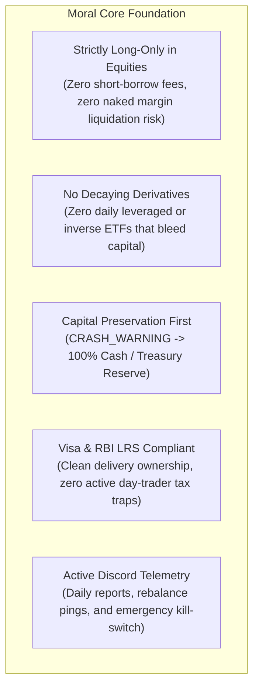
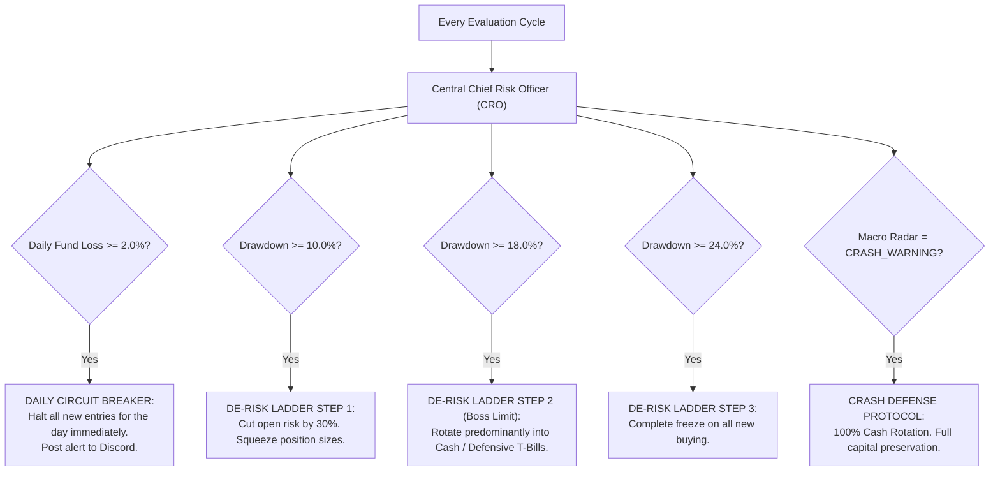
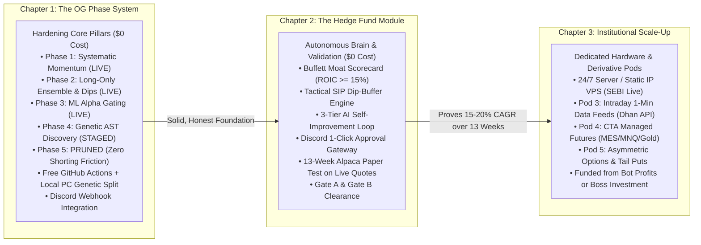
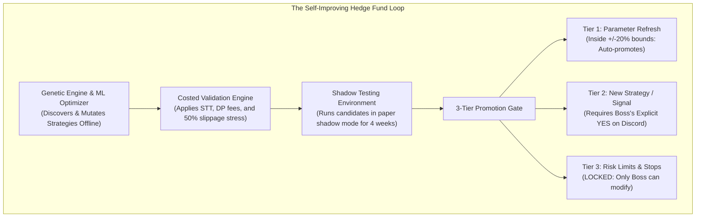
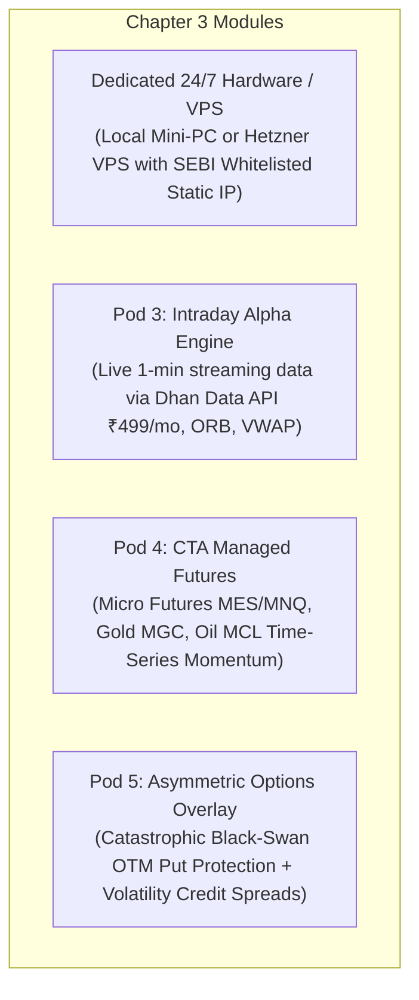

# Quantitative Hedge Fund Bot: The Definitive Master Operating Roadmap

> **Document Classification**: Master Fiduciary Blueprint & Final Architecture  
> **Target Compounding**: 18.0% – 24.0% Long-Term Net CAGR  
> **Capital Mandate**: Lump-sum starting capital (< \$1,000 / ₹50k–₹80k) + Timely SIP Inflows, 100% Pure Geometric Compounding  
> **Primary Alerting & Telemetry**: **Discord Webhook Channel** (Active)  
> **Supreme Fiduciary Governance**: **Central Chief Risk Officer (CRO) Supervisor**

---

## 1. The Moral Core Foundation (Non-Negotiable Invariants)

These foundational principles define the project and can **never be overridden** by any automated algorithm, genetic mutation, or machine learning model:



* **Strictly Long-Only Equities (100% SEBI & RBI LRS Compliant)**: Cash-and-carry delivery ownership only (buying shares and holding them in your demat account). In India, SEBI strictly prohibits retail investors from carrying overnight short positions in the cash market (violators face heavy auction penalties up to 20%), and RBI LRS strictly forbids short-selling overseas. "Long-Only" means we **only buy shares** and **never short-sell**—guaranteeing 100% legal compliance with SEBI and RBI, zero borrow fees, zero auction penalties, and zero margin liquidation risk.
* **No Decaying Derivatives**: Banned from holding leveraged ETFs (e.g., TQQQ/SOXL) or inverse ETFs that suffer volatility drag decay.
* **Capital Preservation First**: When the Macro Radar detects systemic crisis (`CRASH_WARNING`), the system moves **100% to Cash / Risk-Free Treasury Reserve** (zero drawdown, guaranteed principal, earns risk-free yield).
* **Active Discord Integration**: All live alerts, daily performance digests, execution confirmations, and emergency kill-switches remain anchored to **Discord**.

---

## 2. The Central Chief Risk Officer (CRO) Engine

The **Central CRO** sits above all phases, modules, and strategies as the supreme supervisor process. It operates as the fund's fiduciary police:



### The CRO's Core Fiduciary Responsibilities:
1. **The 2.0% Daily Loss Circuit Breaker (Institutional Standard)**:
   - If total portfolio NAV drops **>= 2.0% in a single trading day** (e.g., flash crash, surprise geopolitical shock), the CRO immediately halts all new entries for the remainder of that day and alerts Discord.
   - Prevents emotional knife-catching in falling knives; resting stops and trailing locks remain active.
2. **The Buffett & Lynch De-Risking Drawdown Ladder**:
   - At **-10.0% Drawdown (Peter Lynch Pullback Boundary)**: Normal market breathing room. Cuts total open risk by 30% and tightens entry hurdles.
   - At **-18.0% Drawdown (Buffett Rule #1 Capital Defense Ceiling)**: Deep bear market defense. Rotates portfolio **predominantly into Cash / Defensive T-Bills** to prevent wealth destruction, preserving dry powder to buy at bargain bottoms.
   - At **-24.0% Drawdown**: Complete freeze on all new stock buying.
   - At **-30.0% Drawdown**: Hard emergency circuit breaker (full liquidation and capital quarantine until Boss manual reset).
3. **The 15% Cost-Floor Gate**:
   - Evaluates every prospective trade against exchange fees (Indian STT 0.1%, flat ₹15.34 DP fee, GST, stamp duty; US regulatory and clearing fees).
   - **Rule**: If total estimated transaction costs eat **> 15% of the expected trade profit, the trade is automatically rejected**.
4. **Unitized NAV & Tactical SIP Deployment Engine (Option B - Dip-Buffer Model)**:
   - **Unitized NAV Accounting**: Implements Net Asset Value (NAV) unit accounting (identical to an institutional fund). Deposits (lump sums or recurring SIPs) issue new units at current NAV. **Your deposits are recorded as capital inflows and never falsely counted as trading profit**.
   - **Tactical Cash Reserve Buffer**: Incoming SIP cash does NOT FOMO-chase stocks at all-time highs. It is parked in the Tactical Cash / Liquid Reserve, earning risk-free yield and protecting principal.
   - **Opportunistic Dip Deployment**: Dry powder is selectively deployed when the Phase 2 Mean-Reversion engine detects high-quality oversold pullbacks (RSI14 < 35, Lower Bollinger Band) or top-tier ML breakout setups.
   - **30-Day Tactical Drip Feeder**: If the market enters an extended runaway bull market with no deep pullbacks for 30 consecutive days, the engine gradually drips unspent SIP cash into the highest-ranked momentum compounders so cash never sits permanently idle.
4. **Dynamic Capacity Sizing ($0$ to $10$ Positions)**:
   - Eliminates rigid quotas: holds anywhere from **$0$ to $10$ positions** ($K \in [0, 10]$) based strictly on market conviction and the 15% cost floor.
5. **Fail-Closed Broker Safety**:
   - Eliminates all mock/fake fallbacks. If an API disconnects, the engine immediately **fails closed** (freezes new orders, leaves resting broker GTC stops active, and sends an alert to Discord).

---

## 3. The 3-Chapter Architecture



---

### CHAPTER 1: Hardening the OG Core Phase System (4 Hardened Pillars)
> **Cost to Boss**: **\$0.00** (Current local PC + Free GitHub Actions Cloud)  
> **Mandate**: Harden, clean, and adapt the core pillars for honest execution, Indian fee realities, and zero-cost cloud reliability.

```
========================================================================================
                      THE 4 CORE PILLARS IN CHAPTER 1
========================================================================================
Phase 1: Systematic Momentum & Profit Harvesting (LIVE)
• Trend-Following Momentum: 20-Day ROC normalized by volatility (Score = ROC20 / (vol20 + 0.05)).
• Lynch/Buffett-Compliant 4-Tier Exit & Harvest Ladder:
  1. Tier 1 (Hard Stop): -8.0% immediate liquidation (zero hope-trading, capital preservation).
  2. Tier 2 (Breakeven Lock): At +12.0% gain -> ratchet stop to +2.0% (trade cannot be a loss).
  3. Tier 3 (Partial Profit Harvest): At +20.0% gain -> sell 1/3 (33%) to lock in realized cash,
     feed the Tactical Dip Reserve, and secure early life benefits.
  4. Tier 4 (Trailing Runner): On the remaining 2/3 (67%) -> trails 14% below peak once gain > +30%
     to capture multi-bagger compounders.

Phase 2: Multi-Strategy Long-Only Ensemble (LIVE)
• Adds Quality Mean-Reversion Dip-Buying (Price <= Lower Bollinger Band, RSI14 < 35.0).
• Adaptive Waterfall Budgeting: Dynamically routes unspent dip cash into momentum leaders.
• Dynamic Holdings: Expands from 0 up to 10 positions based on market conviction.

Phase 3: Machine Learning Alpha Gating (LIVE)
• 18 Stationary Technical Features: Normalized RSI, Bollinger Bandwidth, ATR ratio,
  multi-horizon ROC, volume z-scores, Kaufman Efficiency Ratio.
• 100-Tree Random Forest Model (quant_rf_model.joblib) with >= 38% probability hurdle.
• Purged Walk-Forward Splits: Eliminates historical lookahead bias.

Phase 4: Genetic Rules & Loop Engineering (STAGED -> Offline Research Engine)
• Symbolic AST (Abstract Syntax Tree) Strategy Discovery: Rather than hardcoding indicators,
  the genetic engine breeds mathematical formulas and mutates successful strategies.
• Parameter Stability Heatmaps: Replaces brittle curve-fitted values with robust plateaus.
• Walk-Forward Out-of-Sample (WFO) Validation: Prevents the "Overfitting Trap".

[FORMALLY PRUNED] Phase 5: Cointegration Pairs Stat-Arb
• Status: DROPPED per Boss directive. Retail overnight cash shorting is illegal under SEBI
  (auction penalties up to 20%) and prohibited under RBI LRS for US equities.
• Eliminates unnecessary short-borrow friction, margin call liquidation risks, and pairs complexity.
========================================================================================
```

#### The 3-Stage Geographic Progression Pipeline:
1. **Stage 1 (Current Proving Ground - 13 Weeks)**: **US Alpaca Paper Trading**. Current setup continues uninterrupted on live market feeds. Tests the core logic, execution stability, and risk management through 13 consecutive weeks to clear Gate A and Gate B with \$0 out of pocket.
2. **Stage 2 (Real INR Proving Ground - ₹50k to ₹80k)**: **Indian Equities (NSE via Dhan/Groww)**. Once validated on Alpaca, port to Indian live markets with real INR capital. Employs a share price ceiling (₹2,500–₹3,500 max per share) to prevent single-share allocation skew in small accounts. Deducts flat ₹15.34 DP fees, 0.1% STT, GST, and stamp duty.
3. **Stage 3 (Dual-Track Global Compounding)**: **Global US Equities from India**. Expand back to live US markets using Alpaca or Interactive Brokers under the passive RBI Liberalised Remittance Scheme (LRS) route.

#### The Compute & Hardware Split Architecture ($0 Cost):
- **Daily 3:15 PM IST / 3:45 PM ET Cloud Execution**: Runs on **Free GitHub Actions**. Consumes ~2 minutes per run (~44 minutes/month out of 2,000 free minutes). Reads frozen models, scans daily market bars, tracks stops, and dispatches Discord alerts. Runs 100% reliably even if the Boss's PC is powered off.
- **Genetic Strategy Mutation & Retraining**: Runs **locally on the Boss's PC** on weekends or ad-hoc whenever the Boss turns on the PC. Pushes updated lightweight configuration files to Git.
- **Dedicated 24/7 Server/VPS (Chapter 3)**: Deferred until the bot completes 13 weeks of paper trading and the Boss chooses to fund dedicated hardware from trading profits.

#### Chapter 1 Operational Deliverables:
1. **Realistic Fee Engine**: Deducts real STT (0.1%), flat DP charges (₹15.34/sell), GST, and stamp duty in Indian backtests, and regulatory clearing fees in US tests.
2. **Total Return Benchmark**: Benchmarks against S&P 500 / Nifty **with dividends reinvested** (Total Return Index) to prevent exaggerated alpha claims.
3. **Fail-Closed Broker Adapters**: Zero placeholder fallbacks; fails closed safely on any network glitch.
4. **100% Free Cloud Execution**: GitHub Actions scheduled cron at **3:15 PM IST / 3:45 PM ET** (PC can remain turned off).
5. **Discord Channel Alerting**: Real-time trade executions, daily NAV snapshots, and risk warnings piped to your private Discord server.

---

### CHAPTER 2: The Autonomous Hedge Fund Module & Paper Validation
> **Cost to Boss**: **\$0.00** (Zero subscriptions, zero servers)  
> **Mandate**: Layer institutional fundamental moat intelligence and the self-improving genetic loop onto the OG bot, validating forward for 13 weeks on live quotes.



#### Chapter 2 Core Deliverables:
1. **Pod 1: The Buffett Moat & Quality Scorecard (Fundamental Quality Gate)**:
   - **Why This Is Included for Swing & Dip-Buying**: In pure technical systems, momentum bots blindly buy junk companies, debt-laden traps, or pump-and-dump penny stocks simply because their prices spiked. When a technical dip occurs in a junk stock, it frequently crashes to zero. By gating all entries through the Buffett Moat Scorecard, our momentum breakouts and dip buys are restricted *exclusively* to companies with durable competitive moats, pricing power, and pristine balance sheets. This eliminates bankruptcy traps, ensures dips reliably rebound, and allows winning compounders to run safely for multi-month or multi-year wealth generation.
   - **Zero-Cost Fundamental Ingestion**: Evaluates quarterly reports via free APIs (SEC EDGAR / yfinance for US, screener / yfinance for India).
   - **The 4 Fundamental Pillars**: Evaluates **$\text{ROIC} \ge 15.0\%$**, **Gross Margin $\ge 40\%$**, **$\text{Net Debt/EBITDA} < 2.0\times$**, and **Free Cash Flow Yield $\ge 3.5\%$**.
   - Identifies monopolistic compounders that can be held through multi-year runs.
2. **The 3-Tier Autonomous Self-Improvement Loop**:
   - Wires together our **Genetic Strategy Engine (Phase 4)**, **Machine Learning Framework (Phase 3)**, and **Weekly Optimizer**.
   - The loop runs offline on free CPU cycles, discovers new formula variations, shadow-tests them, and promotes them according to the strict 3-tier autonomy hierarchy.
3. **Dual-Mode Order Execution: Autonomous API with 1-Click Safety Fallback**:
   - **Primary Mode (100% Autonomous Hands-Free Execution)**: The bot uses authenticated broker REST APIs (Alpaca for US paper/live; Dhan OpenAPI with automated PyOTP TOTP 2FA authentication for Indian live). It places buy/sell orders autonomously with zero manual effort and posts an execution receipt directly to Discord.
   - **Secondary Mode (1-Click Mobile Safety Net)**: If a broker token expires, or if the broker triggers an interactive 2FA challenge, the bot will NEVER crash or drop the order. It immediately dispatches an interactive Discord card with a pre-filled Dhan basket link:  
     `🟢 BUY 15 shares of BEL @ ₹295.40 | Allocation: 18%`  
     `[🔗 Tap to Execute Dhan Basket Order on Mobile]`  
     You tap the link, confirm with your biometric login, and execute the order in 5 seconds.
   - **Fail-Closed Broker Invariant**: Under any unrecoverable API breakdown (500 Server Error, network timeout), the engine aborts the new order cycle immediately. Zero simulated/mock fallbacks in live mode. All resting broker GTC stops remain active, and an urgent alert is dispatched to Discord.
4. **The 13-Week Paper Phase (Gate A & Gate B Clearances)**:
   - **Gate A (Statistical Stress Clearance)**: Out-of-sample CAGR $\ge 15.0\%$ after all fees/taxes/slippage, max DD $\le -25.0\%$, $\ge 100$ OOS trades, parameter stability plateaus ($\pm 20\%$), Monte Carlo worst 5th-percentile DD within -30.0%.
   - **Gate B (Live Forward Paper Clearance)**: 13 consecutive weeks of forward paper execution on live quotes (Alpaca paper), minimum 4 consecutive weeks of zero crashed runs, live paper performance tracks backtest metrics, and emergency Discord kill-switch drill successfully verified.

---

### CHAPTER 3: Institutional Scale-Up (Funded from Bot Profits)
> **Cost to Boss**: **\$0.00 from personal savings** — funded **100% out of accumulated bot profits** (Trigger: Minimum ₹40,000–₹50,000 net profit earned in Stage 2 live trading + Gates A & B passed).  
> **Mandate**: Deploy dedicated 24/7 hosting, live tick streaming, day trading, and non-correlated derivatives.



#### Chapter 3 Core Deliverables:
1. **Dedicated 24/7 Hosting with Static IP**:
   - **Option A (Home Server)**: Dedicated Ryzen 7/9 Mini-PC (32–64GB RAM, 2TB NVMe SSD, UPS battery backup: ~$600–$800 one-time).
   - **Option B (Cloud VPS)**: Dedicated Hetzner Cloud VPS (~$35–$50/mo) with a permanent whitelisted static IP for fully automated SEBI-compliant execution.
2. **Pod 3: Intraday Day-Trading Alpha Engine**:
   - Subscribes to live 1-minute streaming market data (Dhan Data API ~₹499/mo).
   - Operates **15-Minute Opening Range Breakouts (ORB)** and **VWAP Pullback continuations**.
   - **Strict Flattening Rule**: 100% of intraday positions are closed by 3:15 PM IST / 3:55 PM ET. **Zero overnight gap risk.**
3. **Pod 4: CTA Managed Futures (Macro Crisis Alpha)**:
   - Trades Micro E-mini Futures (`MES`, `MNQ`) and commodities (Gold `MGC`, Crude Oil `MCL`).
   - Uses Time-Series Momentum (TSMOM) to capture profits during equity bear markets and commodity shocks.
4. **Pod 5: Asymmetric Options & Black-Swan Tail Protection**:
   - Allocates 1%–1.5% of fund budget annually to deep out-of-the-money put options (exploding +1,000% to +3,000% in market crashes).
   - Sells defined-risk credit spreads to harvest implied volatility decay ($\theta$) during high-VIX environments.

---

## 4. Master Operational Summary & Responsibilities

| Dimension | Chapter 1 (OG Bot Hardening) | Chapter 2 (Hedge Fund & Loop) | Chapter 3 (Scale-Up & Hardware) |
| :--- | :--- | :--- | :--- |
| **Out-of-Pocket Cost** | **\$0.00** | **\$0.00** | **\$0.00 (Funded from bot profits)** |
| **Hosting Platform** | Free GitHub Actions Cloud + Local PC | Free GitHub Actions Cloud + Local PC | Dedicated Mini-PC or Hetzner VPS |
| **Execution Mode** | Autonomous Cloud REST API | Autonomous API + 1-Click Fallback | Full Sub-Second 24/7 Bus |
| **Notification Channel** | **Discord Webhooks** | **Discord Webhooks + Interactive Cards**| Discord + Real-time Telemetry |
| **Risk Governance** | **Central CRO Supervisor** | **Central CRO + 3-Tier AI Governance** | Central CRO + Real-Time Sub-Second Bus |
| **Trading Styles** | Systematic Swing Momentum & Dip-Buys | Swing + Buffett Moats + Genetic Loop | Swing + Moats + Intraday + Futures + Options |
| **Positions Count** | **Dynamic: $0$ to $10$ positions** | **Dynamic: $0$ to $10$ positions** | Dynamic multi-pod allocations |
| **Cash Inflows** | **Unitized NAV (Lump-Sum + SIPs)** | **Unitized NAV (Lump-Sum + SIPs)** | Unitized NAV (Lump-Sum + SIPs) |
| **Approval Gate** | Internal Code Audit | **Gate A & Gate B (13-Week Paper)** | Earned Profits Trigger (₹40k–₹50k net) |

---

### Verification and Storage

This complete Master Copy has been written directly to your workspace repository:
📁 **[`d:\paper_trading_bot\FINAL_MASTER_HEDGE_FUND_ROADMAP.md`](file:///d:/paper_trading_bot/FINAL_MASTER_HEDGE_FUND_ROADMAP.md)**  
*(Also accessible in conversation artifacts: [`FINAL_MASTER_HEDGE_FUND_ROADMAP.md`](file:///C:/Users/nitin/.gemini/antigravity/brain/d32f06ef-9034-47d9-8e57-b459acf2e424/FINAL_MASTER_HEDGE_FUND_ROADMAP.md))*
