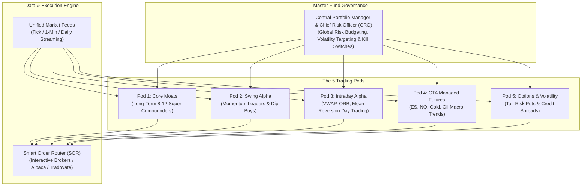
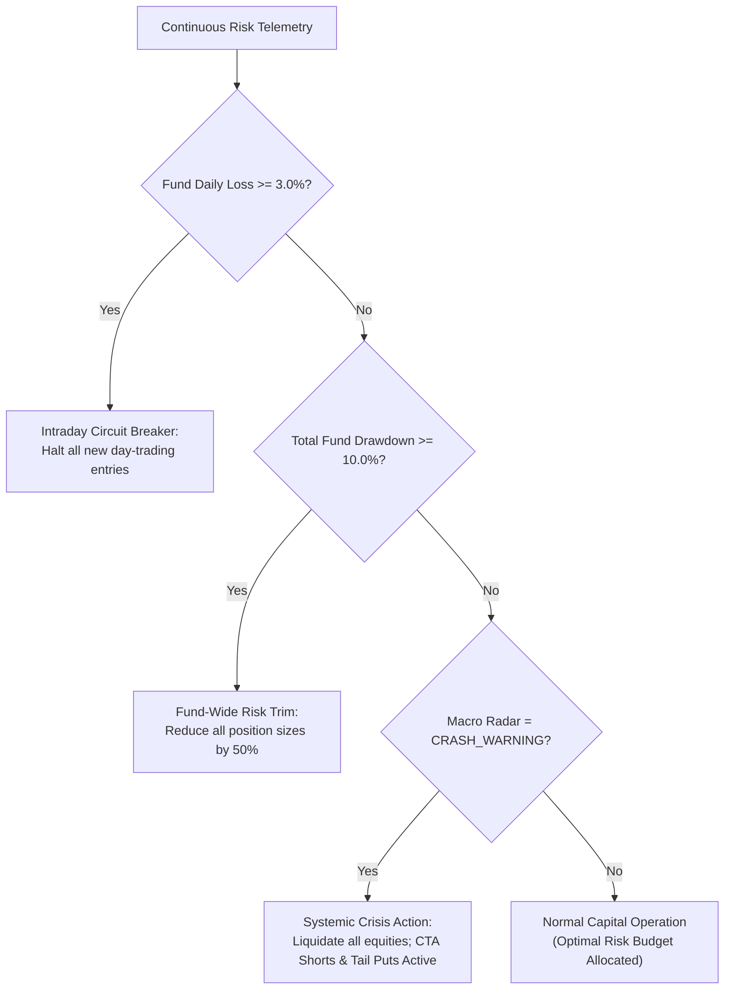
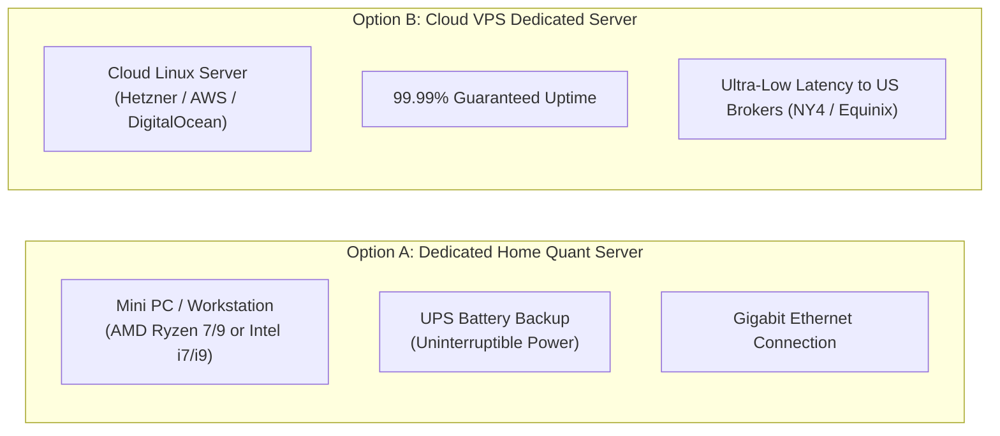
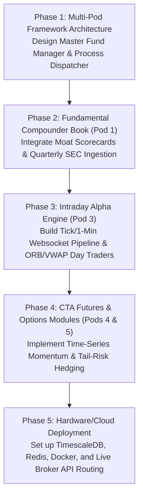

# Autonomous Multi-Strategy Quantitative Hedge Fund: Master Architecture & Hardware Blueprint

> **System Mandate**: Transform the engine into an **Autonomous Multi-Pod Quantitative Hedge Fund** operating simultaneously across **Long-Term Compounders, Systematic Swing, Intraday Day-Trading, CTA Futures, and Asymmetric Options**, coordinated by a centralized **Chief Risk Officer (CRO) Engine**.

---

## 1. Executive Vision: The Citadel / Millennium Multi-Pod Model

Top-tier quantitative hedge funds (such as **Citadel, Millennium, Point72, and AQR**) do not rely on a single strategy or timeframe. A pure day trader misses secular bull market multi-baggers, while a pure buy-and-hold investor suffers through brutal -50% bear market drawdowns.

Modern quantitative funds solve this through **Multi-Strategy Pod Architecture**:
* Capital is divided into **uncorrelated specialized trading books ("Pods")**.
* High-frequency intraday profits provide steady daily cash flow.
* CTA Managed Futures profit during market crashes and inflationary commodity spikes.
* Options harvest structural volatility risk premiums and provide cheap catastrophic tail-risk insurance.
* The Long-Term Compounder book captures secular multi-year 10x moves.

```
========================================================================================
                      MULTI-POD ASSET ALLOCATION & TARGET RETURNS
========================================================================================
POD NAME               INSTRUMENTS            HORIZON         CAPITAL ALLOC   ROLE
----------------------------------------------------------------------------------------
Pod 1: Core Moats      US Large-Cap Equities  6 - 36 Months   35% - 40%       Long-Term Compounding
Pod 2: Swing Alpha     Equities (S&P / Tech)  5 - 45 Days     20% - 25%       Momentum & Dip Capture
Pod 3: Intraday Alpha  Equities / Micro-Fut   Minutes - Hours 15% - 20%       Day-Trading Cash Flow
Pod 4: CTA Futures     ES, NQ, Gold, Crude    Days - Weeks    10% - 15%       Crisis Macro Trend
Pod 5: Vol Overlay     SPY/QQQ Options        Days - Months   5% - 10%        Tail Hedge & Premium
----------------------------------------------------------------------------------------
TARGET PORTFOLIO METRICS: 20% - 28% CAGR | Sharpe Ratio > 1.40 | Max Drawdown < -15.0%
========================================================================================
```



---

## 2. In-Depth Pod Specifications & Trading Logics

### Pod 1: The Core Moat & Compounder Book (Long-Term Investment)
* **Capital Allocation**: 35% – 40%
* **Holding Horizon**: 6 Months to 3 Years
* **Target Universe**: Top 10 S&P 500 Monopolies (Apple, Microsoft, Nvidia, Google, Visa, Costco, Amazon, Berkshire).
* **Core Logics**:
  1. **ROIC Quality Gate**: Companies must maintain \(\text{ROIC} \ge 15.0\%\) and \(\text{Gross Margin} \ge 40.0\%\).
  2. **Fortress Balance Sheets**: \(\text{Net Debt} / \text{EBITDA} < 2.0\times\).
  3. **Dividend Compounding**: Automatically harvests cash dividends and redeploys into the most undervalued constituent.
  4. **Low Turnover**: Rebalanced only quarterly; capital gains compound uninterrupted.

---

### Pod 2: Systematic Swing & Ensemble Allocation (Medium-Term)
* **Capital Allocation**: 20% – 25%
* **Holding Horizon**: 5 to 45 Trading Days
* **Target Universe**: S&P 500 + Nasdaq 100 High-Beta Leaders.
* **Core Logics**:
  1. **4-Pillar Macro Weather Integration**: Automatically reduces exposure from 98% in `BULL_ROTATION` down to 0% in `CRASH_WARNING`.
  2. **Machine Learning Alpha Hurdle**: Random Forest probability gate (\(\ge 0.38\)) on 18 stationary technical features.
  3. **Multi-Tier Dynamic Exits**: Hard stop-loss (-8%), Breakeven ratchet (+12% \(\to\) +2%), and Trailing runner locks (+30% \(\to\) 14% peak trail).

---

### Pod 3: Intraday Alpha Engine (Day Trading Equities & Micro Futures)
* **Capital Allocation**: 15% – 20% (Zero overnight risk; 100% Cash by 3:55 PM ET daily)
* **Holding Horizon**: 2 Minutes to 4 Hours
* **Target Universe**: Highest RVOL (Relative Volume) stocks of the day + Micro E-mini Futures (`MES`, `MNQ`).
* **Core Logics**:
  1. **Opening Range Breakout (ORB)**:
     - Calculates the high and low of the first 15 minutes of trading (9:30 – 9:45 AM ET).
     - Enters on 1-minute volume-weighted candle break above 15-minute high with stop-loss at range midpoint.
  2. **Volume-Weighted Average Price (VWAP) Trend Continuation**:
     $$\text{VWAP}_t = \frac{\sum (\text{Price}_i \cdot \text{Volume}_i)}{\sum \text{Volume}_i}$$
     - In an intraday uptrend, buys high-volume pullbacks to VWAP \(\pm 1.0\sigma\) band.
  3. **Intraday Mean Reversion (Bollinger Bands + 1-Min RSI)**:
     - Extreme intraday exhaustion fades when price pierces \(\pm 2.5\sigma\) Bollinger Bands with 1-minute \(\text{RSI} < 20\) or \(> 80\).
  4. **Strict Flattening Rule**: Every intraday position is automatically closed at 3:55 PM ET. Zero overnight gap risk.

---

### Pod 4: CTA Managed Futures Engine (Macro & Commodity Trends)
* **Capital Allocation**: 10% – 15%
* **Holding Horizon**: 3 Days to 6 Weeks
* **Instruments**: Micro/Mini Index Futures (`MES`, `MNQ`), Commodities (`MCL` Crude Oil, `MGC` Gold), and Treasury Notes (`10Y Yield`).
* **Core Logics**:
  1. **Time-Series Momentum (TSMOM)**:
     - Measures 1-month and 3-month momentum across global asset classes.
     - Long assets with positive trend slope; short assets with negative trend slope.
  2. **Inflation & Crisis Protection**:
     - When equities plunge and inflation surges, commodity futures (Gold, Crude Oil) trend violently upward, providing non-correlated positive returns during equity bear markets.
  3. **Volatility-Adjusted Position Sizing**:
     $$\text{Contracts} = \frac{\text{Pod Capital} \cdot \text{Target Risk \%}}{\text{Contract Dollar Multiplier} \cdot \text{ATR}_{20}}$$
     Ensures high-volatility commodities (like Crude) do not dominate risk over lower-volatility contracts.

---

### Pod 5: Asymmetric Options & Volatility Overlay
* **Capital Allocation**: 5% – 10%
* **Holding Horizon**: 7 Days to 60 Days
* **Instruments**: S&P 500 (`SPY`) and Nasdaq (`QQQ`) Options.
* **Core Logics**:
  1. **Catastrophic Black-Swan Tail Hedging**:
     - Allocates 1.0%–1.5% of fund annual budget to purchase deep out-of-the-money (OTM) put options (e.g., 60-day 15% OTM Puts).
     - During normal markets, the premium decays slowly. During a 2008 or March 2020 crash, these puts explode by **+1,000% to +3,000%**, providing massive cash windfalls precisely at the market bottom.
  2. **Delta-Neutral Volatility Harvesting (High IV Regimes)**:
     - When the Macro Radar detects elevated implied volatility (\(\text{VIX} > 25\)) that is beginning to subside, enters defined-risk Credit Spreads (Bull Put Spreads / Bear Call Spreads) to collect premium decay (\(\theta\)).
  3. **LEAPS Synthetic Long Compounders**:
     - Replaces capital-intensive stock purchases with deep in-the-money (ITM) 1-year to 2-year call options (\(\Delta \ge 0.85\)), freeing up 60% cash while maintaining 100% upside participation in market leaders.

---

## 3. Central Portfolio Manager & Chief Risk Officer (CRO)

A hedge fund fails if one strategy takes down the entire fund. The **CRO Engine** runs every second as a supervisor process:



### Fiduciary Guardrails:
1. **Daily Fund Drawdown Kill-Switch**: If total portfolio equity drops by **\(\ge 3.0\%\) in a single day**, all intraday bots are immediately halted.
2. **Global Max Peak-to-Trough Drawdown**: If drawdown hits **-10.0%**, gross exposure across all pods is automatically slashed by 50%.
3. **Cross-Margin Netting**: Offsets equity longs against short futures hedges, maximizing capital efficiency without paying unnecessary margin borrow fees.

---

## 4. Hardware Sizing & Infrastructure Blueprint

Because this system runs multiple concurrent threads—intraday market data websockets, real-time risk checks, option Greeks calculations, and database logging—it requires reliable, dedicated hardware.

You do **NOT** need an expensive supercomputer. Below are the two recommended production deployment pathways:



---

### Option A: Dedicated Local Quant Mini-PC / Server (One-Time Cost)

A compact, whisper-quiet Mini-PC running 24/7 in your home office:

| Component | Minimum Specification | Recommended Specification | Estimated Cost |
| :--- | :--- | :--- | :--- |
| **Processor (CPU)** | 8 Cores / 16 Threads (AMD Ryzen 7 7700 or Intel Core i7 13th Gen) | 12–16 Cores (AMD Ryzen 9 7900X or Intel i9 14th Gen) | \$250 – \$450 |
| **Memory (RAM)** | 32 GB DDR5 RAM | **64 GB DDR5 RAM** (Handles tick caching & ML models) | \$100 – \$180 |
| **Storage (SSD)** | 1 TB NVMe M.2 PCIe 4.0 SSD | **2 TB Samsung 990 Pro NVMe SSD** (Fast historical reads) | \$90 – \$170 |
| **Network** | 1 Gbps Gigabit Ethernet | Wired Gigabit LAN + 4G/5G Failover Hotspot | \$0 – \$50 |
| **Power Protection**| Standard Surge Protector | **CyberPower / APC 1000VA UPS Battery Backup** (Prevents sudden power cuts) | \$80 – \$140 |
| **Total Hardware Cost**| ~\$550 USD | ~\$850 – \$1,000 USD (Turnkey Mini PC e.g., Minisforum / Beelink) | **One-time purchase** |

---

### Option B: Cloud Dedicated Virtual Server (Monthly Cost — Zero Hardware Maintenance)

If you do not want physical hardware at home, rent a dedicated cloud machine with 99.99% uptime and zero power-cut risks:

| Cloud Provider | Instance Tier | Specifications | Monthly Cost | Best For |
| :--- | :--- | :--- | :--- | :--- |
| **Hetzner Cloud** *(Recommended)* | **CPX41 / CCX23** | 8 vCPUs AMD, 16–32 GB RAM, 240 GB NVMe | **~\$35 – \$60 / mo** | Best price-to-performance ratio in the world |
| **DigitalOcean** | **CPU-Optimized** | 8 vCPUs, 16 GB RAM, 100 GB SSD | **~\$80 / mo** | Easy setup and reliable 1-click deployments |
| **AWS EC2** | **c6i.2xlarge** (US-East-1 N. Virginia) | 8 vCPUs, 16 GB RAM, 200 GB EBS | **~\$120 / mo** | Ultra-low 1ms latency to US exchanges & broker servers |

---

### Operating System & Software Stack
* **Operating System**: **Ubuntu Server 24.04 LTS** (or Windows 11 Pro with WSL2 / Docker).
* **Database Engine**: **TimescaleDB** (PostgreSQL extension optimized for real-time tick and 1-minute time-series candles).
* **In-Memory Cache**: **Redis** (Used for microsecond sub-process message passing between pods).
* **Task Scheduler & Process Manager**: **Systemd** + **Docker Compose** + **Celery**.
* **Visual Telemetry & Monitoring**: **Grafana Dashboard** + **Streamlit** (Real-time P&L, Sharpe, drawdown, and pod performance).
* **Broker Connectivity**:
  - Equities & Options: **Alpaca API** & **Interactive Brokers (TWS / Client Portal API)**.
  - Futures: **Tradovate / NinjaTrader API** or **Interactive Brokers**.

---

## 5. Master Implementation Roadmap: Step-by-Step Evolution



### Phase-by-Phase Plan:
1. **Phase 1: The Multi-Pod Framework (Software Architecture)**
   - Build `trading_system/app/fund/master_fund_manager.py` to route capital dynamically across pods.
   - Build `trading_system/app/fund/chief_risk_officer.py` to enforce global drawdown kill-switches.
2. **Phase 2: Core Moat & Compounder Book (Pod 1)**
   - Ingest quarterly financial statements (ROIC, FCF, Margins).
   - Implement the Long-Term Compounder engine targeting multi-year 10x runners.
3. **Phase 3: Intraday Day-Trading Alpha Engine (Pod 3)**
   - Connect live 1-minute streaming websockets via Alpaca / Interactive Brokers.
   - Implement Opening Range Breakout (ORB) and VWAP mean-reversion engines with strict 3:55 PM daily flattening.
4. **Phase 4: CTA Managed Futures & Options Engine (Pods 4 & 5)**
   - Add micro index futures (`MES`, `MNQ`) trend following.
   - Implement tail-risk OTM put hedging and defined-risk volatility spread harvesting.
5. **Phase 5: Hardware / Server Setup & Live Launch**
   - Deploy on your Mini-PC or Cloud VPS using Docker Compose.
   - Connect live broker accounts, verify paper-trading execution, and monitor via live Grafana telemetry.

---

## 6. Handover Summary & File Locations

This complete master blueprint has been saved directly to your workspace:
📁 **[`d:\paper_trading_bot\FULL_SPECTRUM_HEDGE_FUND_ARCHITECTURE_AND_HARDWARE_PLAN.md`](file:///d:/paper_trading_bot/FULL_SPECTRUM_HEDGE_FUND_ARCHITECTURE_AND_HARDWARE_PLAN.md)**  
*(Also accessible in your conversation artifact directory: [`FULL_SPECTRUM_HEDGE_FUND_ARCHITECTURE_AND_HARDWARE_PLAN.md`](file:///C:/Users/nitin/.gemini/antigravity/brain/d32f06ef-9034-47d9-8e57-b459acf2e424/FULL_SPECTRUM_HEDGE_FUND_ARCHITECTURE_AND_HARDWARE_PLAN.md))*
