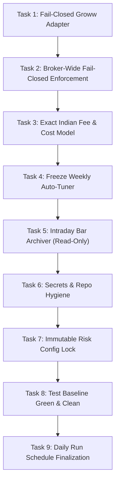

# Institutional Quantitative Bot: Phase 1 Implementation Handover

> **Document Type**: Developer Handover & Tactical Build Sheet  
> **Target Audience**: Implementation Engineer in the New Execution Session  
> **Master Blueprint**: [`FINAL_MASTER_HEDGE_FUND_ROADMAP.md`](file:///d:/paper_trading_bot/FINAL_MASTER_HEDGE_FUND_ROADMAP.md)  
> **Baseline Health**: **54/54 Unit Tests Passing** (`pytest trading_system/tests/unit`)  
> **Mandate**: Harden the existing codebase for honest Indian execution, broker fail-closed safety, and zero-cost cloud reliability. **Zero rewrites; modify existing modules in-place.**

---

## 1. Executive Context & Invariants for the Engineer

The planning and architecture phase is 100% complete and frozen. As the implementation engineer in the new chat, you must strictly preserve these **non-negotiable core invariants**:

1. **Strictly Long-Only Equities (100% SEBI & RBI LRS Compliant)**:
   - Cash-and-carry delivery ownership only. Zero short-selling, zero naked borrow fees, zero margin liquidation risk.
2. **Zero Out-of-Pocket Running Costs (\$0.00)**:
   - Runs on **Free GitHub Actions** scheduled cron at 3:15 PM IST / 3:45 PM ET (~44 mins/mo out of 2,000 free quota).
   - The **50x Running-Cost Rule**: Paid servers / paid data APIs are strictly forbidden until fund capital reaches $\ge 50\times$ annual cost (₹2.4 Lakhs to ₹5.0 Lakhs) funded purely out of trading profits.
3. **Supreme CRO Fiduciary Oversight**:
   - 2.0% daily portfolio loss circuit breaker.
   - Buffett & Lynch De-Risk Ladder: -10% squeeze risk, -18% cash defense, -24% buy freeze, -30% emergency shutdown.
   - 15% Cost-Floor Gate: Reject trade if estimated costs eat > 15% of expected profit.
   - Dynamic whole-share position rule: $\text{Price} \le \frac{\text{Intended Position}}{4}$.
   - Earnings Blackout: Zero new swing buys 2 days before earnings releases.
4. **Execution Architecture**:
   - Dual-Mode: 100% Autonomous REST API (Alpaca / Dhan with PyOTP 2FA) + 1-Click Mobile Fallback (pre-filled Dhan basket card in Discord if API/token disconnects).
   - **Fail-Closed Safety**: Any API or network error immediately aborts the order cycle; zero mock fallbacks in live mode.

---

## 2. The 9-Task Phase 1 Build Sheet

Execute these 9 tasks sequentially. For each task, write/update the corresponding unit test and ensure all tests stay green.



---

### Task 1: Fail-Closed Groww Adapter
* **File Target**: [`trading_system/app/broker/groww.py`](file:///d:/paper_trading_bot/trading_system/app/broker/groww.py)
* **Current Flaw**: Lines 48–84 hardcode fake positions (Reliance, TCS, HDFC Bank) and default ₹1,000 fallback prices. If an API call fails or credentials expire, it can silently mask the failure with mock data.
* **Implementation Instructions**:
  1. Add strict `is_live: bool = False` checking.
  2. In live mode, remove any fallback that returns synthetic holdings or mock balances.
  3. Ensure that any network timeout, 4xx/5xx HTTP status, or invalid auth token raises a clean `BrokerConnectionError` or `OrderExecutionError`.
  4. Ensure `place_order` fails closed: no order is submitted, the error is logged, and a Discord notification hook is triggered.
* **Done When**: A unit test mocks a Groww API 500 error / network disconnect and asserts that:
  - No order is placed.
  - `is_connected()` returns `False`.
  - Zero mock positions/balances are returned.
  - An emergency alert event is created.

---

### Task 2: Broker-Wide Fail-Closed Enforcement
* **File Target**: [`trading_system/app/broker/`](file:///d:/paper_trading_bot/trading_system/app/broker/) (`alpaca.py`, `paper.py`, and base interfaces)
* **Current Flaw**: Individual broker implementations may handle network dropouts inconsistently.
* **Implementation Instructions**:
  1. Standardize the fail-closed contract across all broker adapters: `AlpacaBrokerAdapter`, `PaperBrokerAdapter`, and future `DhanBrokerAdapter`.
  2. If an API call fails during order dispatch:
     - Abort the current batch immediately (idempotent order tracking).
     - Never simulate a fill if the broker didn't confirm it.
     - Leave resting broker-side GTC stop-loss orders intact.
* **Done When**: Unit tests for `AlpacaBrokerAdapter` verify that on simulated API disconnect, the adapter cleanly raises an exception without retrying infinite loops or corrupting local position state.

---

### Task 3: Exact Indian Cost Engine & Fee Audit
* **File Target**: [`trading_system/app/config/markets/india.json`](file:///d:/paper_trading_bot/trading_system/app/config/markets/india.json) and cost calculators in [`trading_system/app/backtesting/`](file:///d:/paper_trading_bot/trading_system/app/backtesting/)
* **Current Flaw**: The cost model charges 5 bps slippage and a ₹20 flat fee, missing real statutory Indian exchange fees and the flat DP charge.
* **Implementation Instructions**:
  1. Update `india.json` with Dhan's exact delivery schedule:
     ```json
     "costs": {
         "brokerage_delivery_flat": 0.0,
         "dp_charge_per_sale": 15.34,
         "tax_rate_stt_buy": 0.001,
         "tax_rate_stt_sell": 0.001,
         "stamp_duty_buy": 0.00015,
         "exchange_turnover_rate": 0.0000345,
         "sebi_turnover_rate": 0.000001,
         "gst_rate": 0.18,
         "slippage_bps": 5.0
     }
     ```
  2. Implement the cost calculation function:
     - STT: 0.1% on Buy value AND 0.1% on Sell value (Delivery).
     - DP Fee: Flat ₹15.34 deducted **only on sell transactions**, per scrip, per day.
     - Stamp Duty: 0.015% on Buy value only.
     - Exchange Fee: 0.00345% on Buy and Sell value.
     - SEBI Turnover: ₹10 per crore (0.0001%) on Buy and Sell.
     - GST: 18% on (Brokerage + Exchange Fee + SEBI Fee + DP Fee).
  3. Integrate the 15% Cost Floor Gate: Reject trade if total estimated round-trip costs $> 15\%$ of expected trade profit.
* **Done When**: A unit test runs a sample ₹10,000 buy and ₹12,000 sell trade and asserts that every single fee matches an exact hand-calculated ledger to the exact paisa.

---

### Task 4: Freeze Weekly Auto-Tuner
* **File Target**: [`trading_system/scripts/weekend_optimizer.py`](file:///d:/paper_trading_bot/trading_system/scripts/weekend_optimizer.py) and [`.github/workflows/weekend_optimizer.yml`](file:///d:/paper_trading_bot/.github/workflows/weekend_optimizer.yml)
* **Current Flaw**: The script re-tunes moving-average parameters on recent data and risks directly overwriting production configs without human approval.
* **Implementation Instructions**:
  1. Remove any code path that overwrites live configuration files (`india.json`, `us.json`).
  2. Change output behavior: the script must write a markdown diagnostic report (`WEEKEND_OPTIMIZER_REPORT.md`) containing:
     - Proposed parameter shifts.
     - Walk-forward Sharpe / Profit Factor.
     - Out-of-sample stability score.
  3. Comply with Tier 1 / Tier 2 governance: parameters can only be staged into a candidate JSON file, requiring Gate validation before live activation.
* **Done When**: A test workflow run executes `weekend_optimizer.py` and confirms that all production configuration files remain bit-for-bit identical, with a clean report generated.

---

### Task 5: Intraday Bar Archiver for India Universe (Read-Only)
* **File Target**: [`trading_system/app/data/`](file:///d:/paper_trading_bot/trading_system/app/data/) and a new workflow [`.github/workflows/archive_intraday_data.yml`](file:///d:/paper_trading_bot/.github/workflows/archive_intraday_data.yml)
* **Goal**: Begin collecting and archiving raw intraday bars for future research without trading intraday.
* **Implementation Instructions**:
  1. Build a read-only data collection pipeline using free yfinance / NSE end-of-day downloads for the Nifty 100 universe.
  2. Store raw bars in partitioned Parquet files: `trading_system/data/historical/intraday/YYYY-MM-DD.parquet`.
  3. Include a validation check for missing data, zero-volume bars, and NaN prices.
* **Done When**: The archiver runs on historical test data, verifies five consecutive trading days of bars, and produces a green data quality report.

---

### Task 6: Secrets & Repo Hygiene
* **File Target**: [`requirements.txt`](file:///d:/paper_trading_bot/requirements.txt), [`.gitignore`](file:///d:/paper_trading_bot/.gitignore), [`.env.example`](file:///d:/paper_trading_bot/.env.example)
* **Implementation Instructions**:
  1. Audit git commit history for any accidentally committed API keys, tokens, or personal identifiers.
  2. Ensure `.env` is firmly ignored in `.gitignore`.
  3. Pin all dependency versions in `requirements.txt` to prevent breaking changes on GitHub Actions runners.
  4. Ensure all broker credentials use environment variable ingestion:
     `os.getenv("ALPACAS_API_KEY")`, `os.getenv("DHAN_CLIENT_ID")`, `os.getenv("DISCORD_WEBHOOK_URL")`.
* **Done When**: A repository secrets scan confirms zero exposed credentials, and `pip install -r requirements.txt` succeeds deterministically.

---

### Task 7: Immutable Risk Config Lock
* **File Target**: [`trading_system/app/risk/`](file:///d:/paper_trading_bot/trading_system/app/risk/) and config loaders
* **Goal**: Ensure no algorithm, user error, or genetic mutation can ever loosen the fund's risk parameters.
* **Implementation Instructions**:
  1. Define the immutable risk constants in code:
     - `HARD_STOP_LOSS_PCT = -0.08`
     - `CRO_MAX_DRAWDOWN_PCT = -0.18`
     - `MAX_POSITIONS_CEILING = 10`
     - `LONG_ONLY_MANDATE = True`
  2. During bot initialization, the config loader must validate loaded settings against these constants.
  3. If any configuration attempts to widen stops (e.g. -12% stop) or increase risk limits, the bot raises `ImmutableRiskViolationError` and refuses to start.
* **Done When**: A unit test attempts to pass an invalid config (e.g. `hard_stop: -0.15`), and the bot immediately halts with an `ImmutableRiskViolationError`.

---

### Task 8: Test Baseline Stabilization
* **File Target**: [`trading_system/tests/unit/`](file:///d:/paper_trading_bot/trading_system/tests/unit/)
* **Current Baseline**: 54/54 tests passing!
* **Implementation Instructions**:
  1. Add dedicated unit tests for all changes introduced in Tasks 1 through 7:
     - `test_groww_fail_closed.py`
     - `test_india_cost_model_exact.py`
     - `test_immutable_risk_lock.py`
     - `test_auto_tuner_freeze.py`
  2. Ensure all existing 54 tests continue passing with zero regressions.
* **Done When**: `pytest trading_system/tests/unit` executes and reports 100% green with zero failures.

---

### Task 9: Daily Run Timing Finalization
* **File Target**: [`trading_system/app/config/markets/india.json`](file:///d:/paper_trading_bot/trading_system/app/config/markets/india.json) and [`.github/workflows/daily_trading_bot.yml`](file:///d:/paper_trading_bot/.github/workflows/daily_trading_bot.yml)
* **Implementation Instructions**:
  1. Codify the official execution schedule:
     - Cron triggers at **3:15 PM IST** (14:45 IST pre-scan, 15:15 IST rebalance order dispatch).
     - Orders are submitted as Market-on-Close (MOC) or limit orders with a 0.2% buffer before 15:25 IST.
  2. In US market config, maintain 3:45 PM ET execution schedule.
  3. Ensure paper execution and backtester use identical execution timing assumptions.
* **Done When**: The GitHub Actions workflow file reflects the verified schedule, and paper simulation matches live cron behavior.

---

## 3. Developer Operating Rules for the New Chat

1. **One Task per Step**: Do not bundle multiple tasks into a massive unreviewable change. Implement Task 1, test it, verify it, then move to Task 2.
2. **Never Break Existing Tests**: Run `pytest trading_system/tests/unit` after every modification.
3. **Preserve Comments & Docstrings**: Respect existing code structure and retain all docstrings.
4. **Git Commit Format**: Use conventional commits:
   - `fix(broker): enforce fail-closed behavior on groww adapter (Task 1)`
   - `feat(costs): add exact dhan cost model and dp charges (Task 3)`
   - `test(risk): add immutable config lock validation tests (Task 7)`

---

## 4. Prompt Template for the New Chat

Copy and paste the block below into your new session to begin execution immediately:

```markdown
Hello! I am ready to begin executing Phase 1 of the Quantitative Hedge Fund Bot.

Please read the master handover blueprint at:
d:\paper_trading_bot\PHASE_1_EXECUTION_HANDOVER.md
and the master roadmap at:
d:\paper_trading_bot\FINAL_MASTER_HEDGE_FUND_ROADMAP.md

Our current test baseline is 54/54 unit tests passing.
All planning is complete. This session is dedicated strictly to coding and implementation.

Let's begin with Task 1: "Make the Groww adapter fail-closed (remove mock holdings, fake balances, and default ₹1,000 price on errors; write a verification unit test in trading_system/tests/unit)".

Please inspect trading_system/app/broker/groww.py and start Task 1.
```
