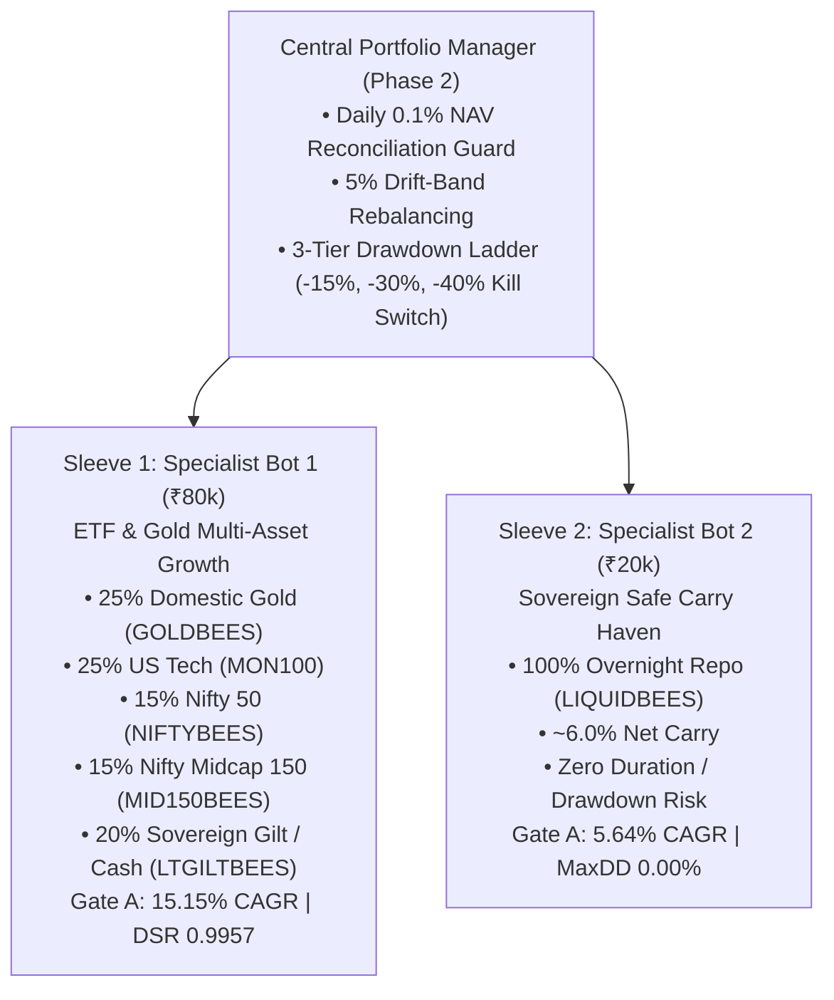

# Institutional Quantitative Multi-Bot Trading System

[](https://github.com/rain2002/trading_bot/actions/workflows/ci.yml)
[](https://github.com/rain2002/trading_bot/actions/workflows/daily_multi_bot_pipeline.yml)
[](https://github.com/rain2002/trading_bot/actions/workflows/shadow_us_alpaca.yml)
[](LICENSE)
[](pyproject.toml)

An autonomous, multi-pod quantitative hedge fund platform operating across **NSE India (Dalal Street)** and **US Equities (Wall Street)**. Built for strict fiduciary accountability, survivorship-bias-free execution, and automated cloud operation.

---

## 1. Production Status & Fiduciary State

| Desk / Pipeline | Branch | Status | Capital / NAV | Drawdown | Governing Protocol |
| :--- | :--- | :---: | :---: | :---: | :--- |
| **India Core Fund (Multi-Bot)** | [`state`](https://github.com/rain2002/trading_bot/tree/state) | **Gate B Incubation** (Day 5/91) | **₹98,082.80** | **-1.92%** | [`PROTOCOL-MANAGER-BOT-CASH-SLEEVE-V1`](trading_system/docs/MANAGER_BOT_AND_CASH_SLEEVE_PROTOCOL_V1.md) |
| **US Shadow Desk (Growth)** | [`state-shadow-us`](https://github.com/rain2002/trading_bot/tree/state-shadow-us) | **Forward Shadow** (Day 0) | **$100,000.00** | **0.00%** | [`US_SHADOW_TRADING_SPEC`](trading_system/docs/US_SHADOW_TRADING_SPEC.md) *(12-Mo. Frozen)* |

---

## 2. Multi-Bot Architecture (The Core Fund)

The live production fund operates under a partitioned multi-sleeve architecture coordinated by the **Central Portfolio Manager**:



### Risk & Capital Safeguards
1. **0.1% Reconciliation Guard**: Every daily session independently re-computes each bot's NAV from cash plus held shares times closing quotes. If independent NAV diverges from reported NAV by $>0.1\%$, the engine halts closed.
2. **3-Tier Drawdown Ladder**:
   - $\text{Drawdown} \le -15\%$: Risk budget reduced to $50\%$; duration forced to $0\%$ (100% cash).
   - $\text{Drawdown} \le -30\%$: Risk budget reduced to $25\%$.
   - $\text{Drawdown} \le -40\%$: Hard emergency kill switch triggers; $100\%$ capital moved to overnight sovereign cash (`LIQUIDBEES`).
3. **Anti-Whipsaw Re-risking**: Re-risking requires 21 consecutive trading days at $+5\%$ above recovery thresholds.

---

## 3. Real-Time Macro Radar & Volatility Gating

Rather than relying on lagged government survey releases (CPI, unemployment), the system ingests live, tradable market-clearing macro proxies:

| Macro Dimension | Live Instrument Proxy | Implementation |
| :--- | :--- | :--- |
| **Yield Curve Inversion** | `^TNX - ^IRX` (US 10Y–3M spread) | Real-time spread tracking; triggers caution on inversions and rate velocity shocks. |
| **Credit Spread Divergence** | `HYG / IEF` (High Yield vs Treasuries) | Flags liquidity freezes and divergences from equity highs before credit headlines break. |
| **Inflation Protection** | `GOLDBEES.NS` (Physical Gold ETF) | 25% permanent allocation in Sleeve 1 as an unlagged, revision-free debasement hedge. |
| **Volatility Scaling** | Barroso & Santa-Clara (2015) $\sigma_{20\text{D}}$ | Scales risk exposure inversely with 20-day realized index volatility against a 15% benchmark. |
| **Panic Crash Gate** | Daniel & Moskowitz (2016) | Forces $0\%$ exposure (`BEAR_DEFENSE`) if 6-month return $< 0$ and $\sigma_{20\text{D}} \ge 24\%$, or close $< 200$-SMA. |

---

## 4. CI/CD & Automated Cloud Execution

The platform is designed to operate with zero manual operational intervention through **GitHub Actions**:

- **Continuous Integration ([`.github/workflows/ci.yml`](.github/workflows/ci.yml))**:
  - **Static Analysis**: Fast `ruff` syntax and undefined variable gate.
  - **Fiduciary Security**: 350+ file scan ensuring zero leaked credentials or account IDs.
  - **Data Integrity**: Audits `trial_log.csv` and all 27 JSON results ledgers.
  - **Test Suite**: Executes all 256 unit tests.
  - **Continuous Delivery**: Compiles the interactive HTML5 web dashboard (`docs/index.html`) as an artifact.
- **Daily India Production Pipeline ([`.github/workflows/daily_multi_bot_pipeline.yml`](.github/workflows/daily_multi_bot_pipeline.yml))**:
  - Runs at 16:13 IST (10:43 UTC) Monday–Friday.
  - Sequentially executes Bot 1 $\to$ Bot 2 $\to$ Central Manager.
  - Commits verified state directly to the isolated `origin/state` branch without dirtying code.
- **US Shadow Forward Pipeline ([`.github/workflows/shadow_us_alpaca.yml`](.github/workflows/shadow_us_alpaca.yml))**:
  - Runs open and close scans on NYSE/NASDAQ sessions.
  - Persists state directly to the `origin/state-shadow-us` branch.

---

## 5. Quickstart & Local Setup

### Prerequisites
- Python 3.11+ (Python 3.12 recommended)
- Git

### Installation
```bash
# Clone the repository
git clone https://github.com/rain2002/trading_bot.git
cd trading_bot

# Create and activate virtual environment
python -m venv venv
# On Windows:
venv\Scripts\activate
# On Linux/macOS:
source venv/bin/activate

# Install dependencies and editable package
pip install -r requirements.txt
pip install -e . --no-deps
```

### Running the Test Suite
```bash
pytest trading_system/tests/unit -v --tb=short
```

### Launching the Interactive Local Dashboard
On Windows, double-click [`LAUNCH_TRADING_DESK.bat`](LAUNCH_TRADING_DESK.bat) or run:
```bash
streamlit run trading_system/dashboard.py --server.port 8501
```

### Containerized Execution (Docker)
```bash
docker build -t hedge-fund-bot .
docker run --rm hedge-fund-bot
```

---

## 6. Repository Documentation & Protocol Index

All strategy specifications, mathematical amendments, and cryptographic SHA-256 protocols are archived in [`trading_system/docs/`](trading_system/docs/):

- **Master Plans & Roadmaps**:
  - [`HEDGE_FUND_BOT_MASTER_PLAN.md`](trading_system/docs/HEDGE_FUND_BOT_MASTER_PLAN.md): Buffett Moat & Multi-Factor Roadmap.
  - [`FINAL_MASTER_HEDGE_FUND_ROADMAP.md`](trading_system/docs/FINAL_MASTER_HEDGE_FUND_ROADMAP.md): 3-Chapter Architecture and Fiduciary Invariants.
  - [`PROJECT_STATUS.md`](trading_system/docs/PROJECT_STATUS.md): Production designations and Gate B tracking.
- **Pre-Registered Protocols (Gate A Verified)**:
  - [`ETF_GOLD_BONDS_ROTATION_PROTOCOL_V1.md`](trading_system/docs/ETF_GOLD_BONDS_ROTATION_PROTOCOL_V1.md) (SHA-256: `2434e15b...`)
  - [`BOND_AND_CASH_BOT_PROTOCOL_V1.md`](trading_system/docs/BOND_AND_CASH_BOT_PROTOCOL_V1.md) (SHA-256: `21ca8098...`)
  - [`MANAGER_BOT_AND_CASH_SLEEVE_PROTOCOL_V1.md`](trading_system/docs/MANAGER_BOT_AND_CASH_SLEEVE_PROTOCOL_V1.md) (SHA-256: `c830025d...`)
- **Forensic Audit Reports**:
  - [`PHASE5_NSE_WHOLE_MARKET_AUDIT_REPORT.md`](trading_system/docs/PHASE5_NSE_WHOLE_MARKET_AUDIT_REPORT.md): Candidate S2 audit and unadjusted split investigation.
  - [`AUDITED_PRE_REGISTERED_MATRIX_RESULTS.md`](trading_system/docs/AUDITED_PRE_REGISTERED_MATRIX_RESULTS.md): Official scorecard across all pre-registered variations.
