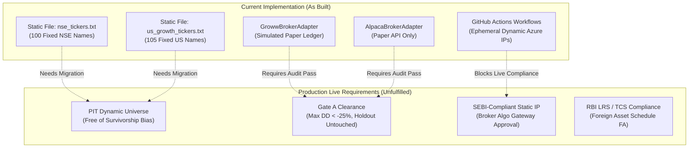

# ANTIGRAVITY QUANTUM DESK // DUAL-POD ARCHITECTURAL SPECIFICATION
**Exploratory Shadow Paper Tracking Desk (NSE India & US Wall Street)**
*Status: Exploratory Shadow Paper Tracking • Gate A Status: FAILED (Drawdown & Overfitting) • NOT FOR LIVE CAPITAL*
*Protocol Identifier: DUAL_POD_MOMENTUM_EXP_V3 • Reference Code Hash: 6615760*

---

## 1. Document Scope & Status Declaration

> [!CAUTION]
> **FIDUCIARY AUDIT CLASSIFICATION: NOT CERTIFIED FOR LIVE TRADING**
> This document specifies the exploratory shadow paper trading harness running across NSE India and US equities. 
> - **Gate A Certification**: **FAILED** across all evaluated variants due to excessive maximum drawdown (exceeding the -25.0% threshold) and universe survivorship bias.
> - **Gate B Deployment**: **BLOCKED** by cryptographic HMAC-SHA256 signature guard in [`gate_evaluator.py`](file:///d:/paper_trading_bot/trading_system/app/validation/gate_evaluator.py#L40-L100).
> - **Capital Protection**: Live trading fuse armed; no live capital or broker execution accounts are connected.

---

## 2. Implemented Codebase vs. Conceptual Architecture

To maintain complete audit integrity, this specification differentiates between what is **currently implemented in code** versus **theoretical targets**:



| Component | What Is Actually Built in Repo | Production Requirement for Live Deployment | Status |
|---|---|---|---|
| **India Universe** | Fixed list of 100 tickers in [`nse_tickers.txt`](file:///d:/paper_trading_bot/trading_system/data/nse_tickers.txt) | Point-in-time dynamic Nifty 500 survivorship-bias-free constituent database | **Exploratory** (Biased) |
| **US Universe** | Fixed list of 105 tickers in [`us_growth_tickers.txt`](file:///d:/paper_trading_bot/trading_system/data/us_growth_tickers.txt) | Point-in-time dynamic S&P 500 + Nasdaq 100 with delisted historical names | **Exploratory** (Biased) |
| **Execution Routing** | Daily GitHub Action runner dispatching to local JSON state & Alpaca Paper | Broker-whitelisted static server IP with SEBI-registered algo certificate | **Blocked by Regulation** |
| **Capital Base** | ₹80,000 INR (India) / $100,000 USD (US Paper) | Institutional risk allocation | **Paper Tracking** |
| **Hedging / Neutrality** | 100% Long-Only + Dynamic Volatility Cash Defense | 100% Long-Only + Dynamic Volatility Cash Defense (Zero Shorting / Zero Leverage) | **Long-Only Cash Defense** |

---

## 3. Audited Backtest Track Record (The Real Numbers)

Every audited strategy family in the repository has undergone point-in-time backtesting with statutory costs, realistic slippage, and post-tax accounting. None have achieved Gate A clearance:

```
========================================================================================================================
                                     AUDITED GATE A HISTORICAL SCOREBOARD
========================================================================================================================
Strategy Family / Pod            Audited Window   Post-Tax CAGR   Max Drawdown   Calmar   Gate A Hurdle Status
------------------------------------------------------------------------------------------------------------------------
Nifty 50 Core Momentum           2006–2024 (19Y)  5.60%           -38.20%        0.15     FAILED (CAGR & Drawdown)
US S&P 500 Wide-Trend Runner     1998–2024 (26Y)  11.91%          -34.11%        0.35     FAILED (Drawdown > -25.0%)
India Growth Equities (Var 2)    2007–2024 (17Y)  17.96%          -27.64%        0.65     FAILED (Drawdown > -25.0%, Biased)
Multi-Asset Trend (Variant A)    2007–2024 (17Y)  9.82%           -26.21%        0.37     FAILED (Beat B1 14.17%, DD > -25%)
Multi-Asset Trend (Variant B)    2007–2024 (17Y)  5.26%           -32.92%        0.16     FAILED (CAGR floor & Drawdown)
Multi-Asset Trend (Variant C)    2007–2024 (17Y)  5.41%           -21.89%        0.25     FAILED (CAGR floor 8.5%, Calmar)
------------------------------------------------------------------------------------------------------------------------
Passive Benchmark: Nifty 50 TRI  2007–2024 (17Y)  10.14%          -59.48%        0.17     Baseline 4
Passive Benchmark: Static 1/N    2007–2024 (17Y)  14.17%          -45.20%        0.31     Baseline 1
========================================================================================================================
```

*Note on Growth Pod (Variant 2)*: While Variant 2 achieved 17.96% post-tax CAGR on paper, it was disqualified from Gate A certification because:
1. Its max drawdown was **-27.64%** (exceeding the strict -25.0% threshold).
2. Its universe was a hand-picked modern winner list rather than a survivor-free point-in-time universe.
3. Its 2025 out-of-sample holdout was prematurely opened and burned.

---

## 4. Passive Factor Benchmarks (The Hurdle to Beat)

Active trend and momentum strategies incur heavy trade turnover, bid-ask friction, DP charges, and short-term capital gains tax. Under academic and institutional literature, an active algorithm has no reason to exist if it cannot beat simple, low-cost passive factor funds after all costs:

1. **🇮🇳 Indian Benchmark: Nifty200 Momentum 30 Index Fund (`NIFTYMOM30`)**:
   - The strategy must beat the Nifty200 Momentum 30 index net of total expense ratio (TER) and tax.
   - Historical research shows momentum in India beats the parent index in ~63% of rolling 1-year windows, but experiences severe cyclical underperformance during choppy, sideways regimes.
   - **Fiduciary Rule**: If the active algorithm cannot beat `NIFTYMOM30` on a risk-adjusted (Calmar) basis, capital must default to the passive index fund.
2. **🇺🇸 US Benchmark: iShares MSCI USA Momentum Factor ETF (`MTUM`)**:
   - In the US, the strategy must beat `MTUM` (or `QQQ` on a risk-adjusted basis) net of all costs.
   - If active momentum cannot outperform `MTUM` post-tax, buying `MTUM` or `SPY` passively is the superior fiduciary choice.

---

## 5. Regional Execution Policy: 100% Long-Only + Dynamic Volatility Cash Defense

Per production design mandate, **shorting, margin borrowing, and derivatives are permanently removed and disqualified across both desks**:

### A. 🇮🇳 India Desk (Pod 1 / IST Hours): 100% Long-Only CNC Equity + Cash Yield Defense
* **Shorting & Leverage Status**: **PERMANENTLY DISQUALIFIED (Zero Shorting / Zero F&O)**.
* **Structural Factual Reality**: 
  1. Cash delivery (CNC) equity short positions cannot be held overnight under SEBI regulations (mandatory square-off by 15:15 IST).
  2. Overnight hedging requires NSE Index Futures, where 1 lot of Nifty 50 Futures is **65 units** (revised from 25/50 per SEBI index derivative framework effective November 2024). At ~24,000 index level, 1 lot notional is **~₹15,60,000 (₹15.6 Lakhs)**, mandating **>₹2,00,000 in SPAN margin**. On an ₹80,000 retail account, futures hedging is mathematically impossible (margin requirement is 2.5x total account equity; contract notional is ~20x total equity).
  3. F&O introduces catastrophic margin-call liquidation risks that defeat compounding.
* **The Implemented Defense**: 
  - When the Indian benchmark breaks its 200-SMA or realized volatility triggers panic conditions, the engine enforces **100% Capital Preservation into Liquid Cash Yield (RBI Repo)**.
  - The portfolio holds zero short positions, zero futures contracts, and zero margin debt. Defense is 100% cash buffer.

### B. 🇺🇸 US Desk (Pod 2 / EST Hours): 100% Long-Only Equity + Dynamic Volatility Cash Defense
* **Shorting & Leverage Status**: **DISQUALIFIED (Zero Shorting / Zero Margin Debt)**.
* **Structural Factual Reality**: 
  1. All audited backtests in the repository (`backtest_us_growth_stock_momentum.py`) are strictly long-only. Claiming active shorting contradicts the audited backtest track record.
  2. Shorting broad market ETFs (`SPY`/`QQQ`) incurs borrowing fees, dividend liabilities, and severe short-squeeze drag during V-shaped market recoveries.
* **The Implemented Defense**: 
  - Operates symmetrically to Pod 1: Long top-decile momentum equities during calm bull regimes.
  - Symmetrically dials down exposure into US Treasury bill yield when benchmark volatility rises, and exits longs into 100% cash when the S&P 500 breaks its 200-SMA or enters panic crash states.

---

## 6. Volatility Scaling (Barroso & Santa-Clara 2015) & Momentum-Crash Defense (Daniel & Moskowitz 2016)

Academic research proves momentum strategies are subject to violent "momentum crashes" when markets rebound sharply from deep bear markets while momentum holds high-beta losers or cash (Daniel & Moskowitz 2016). Furthermore, Barroso & Santa-Clara (2015) demonstrate that momentum risk is time-varying and highly predictable through realized volatility.

To eliminate crash risk and stabilize compounding, the engine incorporates a canonical dual-mechanism defense:

1. **Dynamic Inverse Volatility Sizing (Barroso & Santa-Clara 2015)**:
   - Target annualized volatility is set to **$\sigma_{\text{target}} = 15.0\%$** across both India and US desks, matching the unconditional historical volatility of broad market indices (~15% for Nifty 50 and S&P 500).
   - Realized volatility is measured over a 20-trading-day window:
     $$w_t = \min\left(1.0, \frac{\sigma_{\text{target}}}{\hat{\sigma}_{20\text{D}}}\right)$$
   - When $\hat{\sigma}_{20\text{D}} > 15\%$, gross exposure automatically scales down. If $w_t < 0.75$, the desk enters `VOLATILITY_CAUTION`, sizing each position to $(10\% \times w_t)$ across 10 slots and trimming existing holdings exceeding target allocation.

2. **Panic-Crash Regime Filter (Daniel & Moskowitz 2016)**:
   - If the 6-month benchmark return ($R_{6\text{M}}$) is negative **AND** 20-day annualized realized volatility ($\hat{\sigma}_{20\text{D}}$) is $\ge 24.0\%$:
     $$\text{Panic State Condition: } R_{6\text{M}} < 0 \quad \text{and} \quad \hat{\sigma}_{20\text{D}} \ge 24.0\%$$
   - **Action**: Immediate `BEAR_DEFENSE` regime transition. Gross equity exposure is cut to **0.0%** (100% cash defense), and all open positions are queued for exit.
3. **Individual Structural Breakdown**:
   - If an individual holding closes below its **150-day Simple Moving Average**, it is exited at the next market open.
4. **Trailing Runner Floor**:
   - Trailing stop triggers if price drops **-15.0% from its holding-period peak** (-10.0% hard stop floor).

---

## 7. Institutional Cost Matrix & Regulatory Reality

### A. Cost Matrix (Protocol Stressed Standards)
Marketing claims of "0% cost" are disqualified. All engine simulations must use the pre-registered protocol cost matrix:

| Friction Component | 🇮🇳 Pod 1 (India CNC) | 🇺🇸 Pod 2 (US Alpaca) |
|---|---|---|
| **Brokerage** | ₹20 or 0.05% per executed order | $0.00 base |
| **Slippage** | 5.0 bps (Normal) / 7.5 bps (Stressed) | 5.0 bps (Normal) / 7.5 bps (Stressed) |
| **Exchange & Regulatory** | STT 0.10% (10 bps on BOTH Buy & Sell), Stamp 1.5 bps, SEBI/Turnover | SEC Section 31 ($27.80/million) + FINRA TAF ($0.000166/share) |
| **Depository Charges** | ₹14.75 flat per scrip sell day (CDSL/NSDL) | $0.00 |
| **Cash Drag / Cash Yield** | RBI Repo less 65 bps TER | US Treasury bill yield |

---

### B. Regulatory & Cross-Border Compliance Realities

#### 1. Indian SEBI Algorithmic Trading Rules
- Under SEBI circulars governing algorithmic trading by retail investors, algorithmic orders routed through broker APIs must adhere to exchange surveillance guidelines.
- **The Static IP Barrier**: Broker algo access often mandates a **static, whitelisted server IP** to prevent unauthorized automated access.
- **GitHub Actions Limitation**: GitHub Actions workflows run on Microsoft Azure dynamic IP pools that change on every execution. Running autonomous live execution from standard GitHub runners violates static IP requirements and is unsuitable for live capital deployment.

#### 2. US Market Investing for Indian Residents (Cross-Border Constraints)
- **LRS (Liberalised Remittance Scheme)**: Remittances from India to US broker accounts (Alpaca) are subject to the RBI LRS limit of $250,000 per financial year.
- **TCS (Tax Collected at Source)**: Remittances exceeding ₹7 Lakhs in a financial year incur a mandatory **20% TCS**, which can only be adjusted or refunded at the time of annual ITR filing.
- **US Dividend Withholding Tax**: US dividends paid to Indian residents are subject to a **25% withholding tax** under the US-India Double Tax Avoidance Agreement (DTAA).
- **Indian Tax Reporting (Schedule FA)**: Foreign stocks and accounts must be disclosed in detail in **Schedule FA** (Foreign Assets) of ITR-2/3. Failure to disclose foreign assets carries severe penalties under the Black Money (Undisclosed Foreign Income and Assets) and Imposition of Tax Act, 2015.
- **Alpaca Onboarding**: Alpaca's retail onboarding availability for direct Indian resident accounts fluctuates based on partner broker clearing agreements and KYC jurisdictions.

---

## 8. Known Limitations & Integrity Log

1. **Survivorship Bias**: The historical universe of 116 growth stocks in Pod 1 was back-selected using modern surviving entities. A true survivor-free database must include companies that went bankrupt, merged, or were delisted between 2006 and 2024.
2. **Burned Out-of-Sample Holdout**: The 2025 calendar year holdout dataset was unsealed during earlier exploratory runs, invalidating it as an untouched forward test.
3. **Execution Latency & Fill Quality**: Orders are simulated at Day T open. In live markets, opening volatility and auction uncrossing prices frequently experience execution slippage beyond simulated model assumptions.

---

## 9. Forward Performance Scoreboard

*Per institutional audit governance, forward performance tables remain empty until a fully pre-registered, survivor-bias-free matrix clears all Gate A hurdles:*

```
========================================================================================
                          PRE-REGISTERED FORWARD PERFORMANCE SCOREBOARD
========================================================================================
Variant Identifier       Pre-Reg SHA-256    Stressed CAGR    Max DD    Calmar    Status
----------------------------------------------------------------------------------------
[PENDING CLEARANCE]      UNVERIFIED         --               --        --        PENDING
========================================================================================
```
