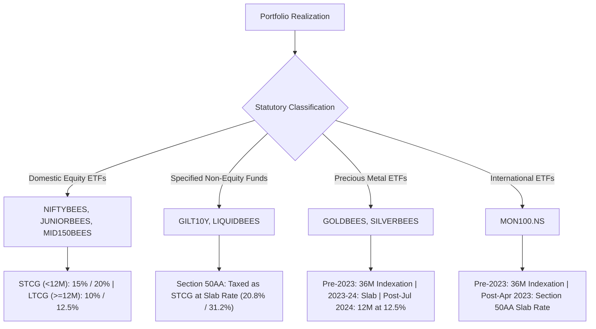

# PRE-REGISTERED PROTOCOL SPECIFICATION: MULTI-ASSET TACTICAL TREND ENGINE (V2.1 AMENDMENT)
**Document Identifier**: `MULTI_ASSET_TREND_PROTOCOL_V2_1`  
**Registration Date**: 2026-11-07  
**In-Sample Test Window**: 2007-09-24 to 2024-12-31 (17.27 calendar years | 4,206 trading sessions)  
**Untouched Holdout Window**: 2025-01-01 to 2025-12-31 (Strictly Sealed & Untouched)  
**Primary Capital Base**: ₹80,000.00 INR  
**Protocol Status**: FORMALLY PRE-REGISTERED PRIOR TO CODE MODIFICATION & SIMULATION  
**Prior Protocol Lineage**:  
- `MULTI_ASSET_TREND_PROTOCOL_V1_0` (commit `772cf17`): Formally tagged **Exploratory Post-Hoc** (protocol, script, and results committed simultaneously; in-sample winner bias; post-hoc hurdles).  
- `MULTI_ASSET_TREND_PROTOCOL_V2_0` (commit `3643b3c`): Committed alone; pre-registered broader universe and Gate A criteria; superseded by this V2.1 amendment to rectify statutory tax nuances, back-fill listing gaps, specify asset-specific slippages/STT, select a single US instrument with premium stress, and define tie-break/all-fail decision rules.  

---

## 1. Executive Summary & Scope of V2.1 Amendments

This protocol provides the definitive, mathematically locked specification for the **Multi-Asset Tactical Trend Engine (V2.1)**. It addresses all feedback from peer review:

1. **CA-Aligned Statutory Indian Tax Regime**: Corrects Section 50AA scope across financial years (distinguishing domestic equity, debt, gold/silver, and international funds) and incorporates a dual-bracket tax sensitivity analysis (20.8% and 31.2% slab rates).
2. **Explicit Historical Back-Filling Methodology**: Details exact launch dates for all exchange-traded funds, establishes synthetic index proxy rules with full TER deduction plus a mandatory **15 bps annual tracking drag penalty**, and tests both Full Synthetic and Listing-Eligibility Dynamic modes.
3. **Unambiguous Single US Instrument (`MON100.NS`) & Premium Stress**: Replaces dual LRS/ETF ambiguity with `MON100.NS` as the single benchmarked US asset, applying a realistic **1.50% entry premium stress** to simulate RBI overseas quota exhaustions.
4. **Dynamic Nifty TRI Benchmark Binding Hurdle**: Eliminates hardcoded TRI percentages; requires dynamic post-tax computation during backtest execution.
5. **Asset-Specific Slippage & Statutory STT Matrix**: Implements realistic liquidity-tiered slippage (from 2.0 bps to 25.0 bps) and exempts non-equity ETFs (Gold, Silver, Gilt, Liquid) from equity Securities Transaction Tax (STT) per Indian tax statutes.
6. **Sourced Depository Participant (DP) Fee**: Sources the ₹14.75 flat exit charge to CDSL tariff circulars and retail brokerage schedules.
7. **Deterministic Tie-Break and All-Fail Decision Rules**: Pre-commits the exact selection algorithm if multiple variants pass and the mandatory failure fallback if all variants fail.

---

## 2. Universal Macro Universe & Real Investable Instruments

The strategy evaluates 7 macro asset classes plus Sovereign Liquid Cash. To ensure institutional implementability, every asset class is mapped to an active NSE-listed Exchange Traded Fund (ETF):

| Asset Class | Proxy Symbol | Real Investable Instrument | Underlying Benchmark | NSE Listing Date | Annual TER | Normal Slippage | Stressed Slippage | Statutory STT (Sell) |
| :--- | :--- | :--- | :--- | :---: | :---: | :---: | :---: | :---: |
| **Indian Large-Cap Equities** | `NIFTY50` | Nippon India ETF Nifty 50 BeES (`NIFTYBEES.NS`) | Nifty 50 Total Return Index | Dec 2001 | **0.05%** | 5.0 bps | **7.5 bps** | 0.10% (10 bps) |
| **Indian Next 50 (Large-Mid)** | `NEXT50` | Nippon India ETF Nifty Next 50 Junior BeES (`JUNIORBEES.NS`) | Nifty Next 50 Total Return Index | Feb 2003 | **0.22%** | 7.5 bps | **12.0 bps** | 0.10% (10 bps) |
| **Indian Midcap Equities** | `MIDCAP150` | Nippon India ETF Nifty Midcap 150 (`MID150BEES.NS`) | Nifty Midcap 150 Total Return Index | Jan 2019 | **0.22%** | 10.0 bps | **15.0 bps** | 0.10% (10 bps) |
| **Gold (in INR)** | `GOLDBEES` | Nippon India ETF Gold BeES (`GOLDBEES.NS`) | Domestic Spot Gold Price (MCX Spot / LBMA in INR) | Mar 2007 | **0.80%** | 7.5 bps | **12.0 bps** | **0.00% (Exempt)** |
| **Silver (in INR)** | `SILVERBEES`| Nippon India Silver ETF (`SILVERBEES.NS`) | Domestic Spot Silver Price (MCX Spot in INR) | Jan 2022 | **0.45%** | 15.0 bps | **25.0 bps** | **0.00% (Exempt)** |
| **Long Sovereign G-Sec** | `GILT10Y` | Nippon India ETF Nifty 10 yr Benchmark G-Sec (`NETFGILT.NS`) | CCIL 10-Year Benchmark G-Sec Index | Jul 2016 | **0.16%** | 15.0 bps | **25.0 bps** | **0.00% (Exempt)** |
| **US Secular Technology** | `MON100` | Motilal Oswal Nasdaq 100 ETF (`MON100.NS`) | Nasdaq 100 Index in INR (`^NDX * USDINR=X`) | Mar 2011 | **0.35%** | 12.0 bps | **20.0 bps** | **0.00% (Exempt)** |
| **Sovereign Liquid Yield** | `CASH_INR` | Nippon India ETF Liquid BeES (`LIQUIDBEES.NS`) | RBI Repo Rate Schedule | Jul 2003 | **0.65%** | 1.0 bps | **2.0 bps** | **0.00% (Exempt)** |

### US Asset Selection & Premium Stress Protocol
- **Primary Chosen Vehicle**: `MON100.NS` (Motilal Oswal Nasdaq 100 ETF). LRS / direct US ETF routes are rejected for Gate A testing due to high 20% Tax Collected at Source (TCS) lockup friction and wire transfer costs.
- **US Exposure Mandate**: US exposure is intentionally restricted to secular mega-cap technology via the Nasdaq 100 due to its proven low structural correlation to domestic Indian equities and positive rupee-depreciation hedge.
- **Quota & Premium Stress Model**: Because Indian mutual funds face an aggregate industry overseas investment ceiling of $7 Billion (RBI mandate), domestic international ETFs frequently trade at premiums to NAV when creation units are halted. In the stressed Gate A evaluation:
  - Every purchase of `MON100.NS` incurs an additional **1.50% entry premium surcharge** (bought at 1.5% above NAV).
  - Every sale is credited at pure NAV (0.0% premium exit), conservatively assuming full mean-reversion of the premium during holding.

---

## 3. Historical Back-Filling & Proxy Disclosures (2007–2024 Gaps)

Because several modern thematic ETFs listed after the September 2007 in-sample inception date, the simulation enforces a dual-mode disclosure:

### Historical Listing Timelines & Underlying Proxies

| Asset Class | Active ETF | Listing Date | Pre-Inception Proxy Series | Pre-Inception Drag Charged |
| :--- | :--- | :---: | :--- | :--- |
| `NIFTY50` | `NIFTYBEES.NS` | Dec 2001 | Continuous Live ETF history throughout (2007–2024). | Real traded market price. |
| `NEXT50` | `JUNIORBEES.NS`| Feb 2003 | Continuous Live ETF history throughout (2007–2024). | Real traded market price. |
| `GOLDBEES` | `GOLDBEES.NS` | Mar 2007 | Continuous Live ETF history throughout (2007–2024). | Real traded market price. |
| `MIDCAP150` | `MID150BEES.NS`| Jan 2019 | 2007 to Dec 2018: Nifty Midcap 150 Total Return Index (`^CRSLDX` / Midcap 50 TRI). | **0.22% TER + 15 bps Tracking Drag**. |
| `MON100` | `MON100.NS` | Mar 2011 | 2007 to Feb 2011: Nasdaq 100 Total Return Index $\times$ USD/INR Spot FX. | **0.35% TER + 15 bps Tracking Drag + 1.5% Premium Stress**. |
| `GILT10Y` | `NETFGILT.NS` | Jul 2016 | 2007 to Jun 2016: CCIL All Sovereign 10-Year Benchmark G-Sec TRI. | **0.16% TER + 15 bps Tracking Drag**. |
| `SILVERBEES`| `SILVERBEES.NS`| Jan 2022 | 2007 to Dec 2021: MCX Spot Silver Price / Global Spot Silver $\times$ USD/INR. | **0.45% TER + 15 bps Tracking Drag**. |

### Mandatory Dual-Mode Evaluation
1. **Mode A (Full Synthetic Proxy Mode - Primary Gate A)**: The 17-year continuous backtest is evaluated from 2007 to 2024 utilizing the proxy series prior to ETF listing dates, with every proxy period burdened by the full statutory TER plus a **15 bps annual tracking error penalty**. Every simulated fill during a proxy period is tagged as `[SYNTHESIZED_INDEX_PROXY]`.
2. **Mode B (Listing-Eligibility Dynamic Mode - Diagnostic Sensitivity)**: An asset only becomes eligible for portfolio selection on the first calendar rebalance following its official exchange listing date. Before listing, its allocation weight remains in Sovereign Liquid Cash.
   - *Pass Requirement*: Mode A must clear all Gate A hurdles. Mode B must verify that strategy Sharpe and CAGR did not depend on pre-listing proxy availability.

---

## 4. Statutory Instrument-Specific Indian Tax Regime

As established under the Income Tax Act, 1961 (incorporating amendments up to Finance Act 2023 Section 50AA and Finance (No. 2) Act 2024), capital gains and income are taxed per distinct statutory class:

### Statutory Tax Rules per Instrument

#### A. Domestic Equity ETFs (`NIFTYBEES`, `JUNIORBEES`, `MID150BEES`)
- **Holding Period Threshold**: 12 calendar months (365 days).
- **Short-Term Capital Gains (STCG)** ($< 365$ days):
  - Prior to 23-Jul-2024: **15.0%** (+ 4% Health & Education Cess = **15.6%**).
  - On or after 23-Jul-2024: **20.0%** (+ 4% Cess = **20.8%**).
- **Long-Term Capital Gains (LTCG)** ($\ge 365$ days):
  - Prior to 01-Apr-2018: **0.0%** (Section 10(38) full exemption).
  - 01-Apr-2018 to 22-Jul-2024: **10.0%** (+ 4% Cess = **10.4%**) on aggregate annual gains exceeding ₹1,00,000.
  - On or after 23-Jul-2024: **12.5%** (+ 4% Cess = **13.0%**) on aggregate annual gains exceeding ₹1,25,000.

#### B. Long Sovereign Gilt (`NETFGILT`) and Liquid Cash (`LIQUIDBEES`)
- **Prior to 01-Apr-2023**:
  - STCG ($< 36$ months): Marginal slab rate.
  - LTCG ($\ge 36$ months): 20.0% with Cost Inflation Index (CII) indexation.
- **On or after 01-Apr-2023 (Section 50AA - Specified Mutual Funds)**:
  - Mutual funds investing $\le 35\%$ in domestic equity shares are deemed short-term capital assets regardless of holding period. All gains are taxed at the investor's marginal slab rate (zero indexation).
- **Cash Compounding Interest / Yield**:
  - Fully taxed as income from other sources at the investor's slab rate compounded daily across all years:
    $$\text{Effective Daily Net Yield} = \frac{\max(0, \text{Repo Rate} - 0.0065)}{252} \times (1 - \text{Slab Tax Rate})$$

#### C. Gold and Silver ETFs (`GOLDBEES`, `SILVERBEES`)
- **Prior to 01-Apr-2023**:
  - STCG ($< 36$ months): Marginal slab rate.
  - LTCG ($\ge 36$ months): **20.0% with CII indexation**.
- **01-Apr-2023 to 22-Jul-2024 (Section 50AA Interpretation Window)**:
  - During this transitional window, funds investing $\le 35\%$ in domestic equities were classified as specified mutual funds; gains taxed at marginal slab rates across all holding periods.
- **On or after 23-Jul-2024 (Finance (No. 2) Act 2024 Listed Asset Reform)**:
  - Gold and Silver ETFs classified as listed financial assets:
  - Holding threshold reduced to **12 calendar months**.
  - STCG ($< 12$ months): Marginal slab rate.
  - LTCG ($\ge 12$ months): **12.5% without indexation** (+ 4% Cess = **13.0%**).

#### D. International ETFs (`MON100.NS`)
- **Prior to 01-Apr-2023**:
  - STCG ($< 36$ months): Marginal slab rate.
  - LTCG ($\ge 36$ months): **20.0% with CII indexation**.
- **On or after 01-Apr-2023 (Section 50AA)**:
  - International funds hold 0% domestic equities and are treated as Specified Mutual Funds: all gains are taxed as STCG at the investor's marginal slab rate.

### Mandatory Dual-Bracket Slab Sensitivity Analysis
Because an investor's marginal tax rate depends on personal tax brackets, all simulations must report two complete tax schedules:
1. **Primary Gate A Schedule (30% Bracket + 4% Cess = 31.2% Slab Rate)**: Represents standard High-Net-Worth Individuals (HNIs) and professional trading entities.
2. **Sensitivity Schedule (20% Bracket + 4% Cess = 20.8% Slab Rate)**: Represents intermediate retail investors.

---

## 5. Statutory Execution, Depository Participant (DP) Charges & Friction Schedule

### Sourced Depository Participant (DP) Fee
Every sale of an ETF scrip incurs a flat Depository Participant charge:
- **Statutory Source**: CDSL Revised Tariff Circular `CDSL/OPS/DP/POLCY/2024/491` and [Zerodha Retail Equity Tariff Schedule](https://zerodha.com/charges/#tab-equities).
- **Fee Breakdown**: CDSL depository charge ₹3.50 + Broker DP charge ₹9.00 = ₹12.50 base charge + 18% GST (₹2.25) = **₹14.75 flat per scrip sell day**.

### Statutory Brokerage, Taxes & Slippage Matrix

| Cost Component | Domestic Equity ETFs (`NIFTY50`, `NEXT50`, `MIDCAP150`) | Precious Metal & Debt ETFs (`GOLDBEES`, `SILVERBEES`, `NETFGILT`, `MON100`) | Liquid Yield ETF (`LIQUIDBEES`) |
| :--- | :---: | :---: | :---: |
| **Brokerage (Discount/Institutional)** | 0.05% (capped ₹20/order) | 0.05% (capped ₹20/order) | 0.00% (free / ₹0) |
| **Securities Transaction Tax (STT - Delivery Sell)** | **0.10% (10.0 bps)** | **0.00% (Exempt)** | **0.00% (Exempt)** |
| **Exchange Turnover Charges (NSE)** | 0.00297% (0.297 bps) | 0.00297% (0.297 bps) | 0.0010% (0.10 bps) |
| **SEBI Turnover Fee** | 0.0001% (0.01 bps) | 0.0001% (0.01 bps) | 0.0001% (0.01 bps) |
| **Stamp Duty (Buy Only)** | 0.015% (1.50 bps) | 0.015% (1.50 bps) | 0.005% (0.50 bps) |
| **Goods & Services Tax (GST on Brokerage+Turnover)**| 18.0% | 18.0% | 18.0% |
| **Execution Delay Invariant** | Signal at Close $T-1$; Filled at Open $T$ | Signal at Close $T-1$; Filled at Open $T$ | Daily NAV parity |

---

## 6. Mandatory Baseline Benchmarks

All strategy variants are benchmarked against four formal baselines across the exact same 2007–2024 period with identical statutory tax and execution costs:

1. **Baseline 1: Static Equal-Weight Multi-Asset Benchmark ($1/N$)**:
   - Equal-weight allocation across all candidate macro assets, rebalanced annually on the first trading day of January.
   - Rebalancing trades subject to standard DP charges, transaction costs, and instrument-specific capital gains tax.
   - *Mandate*: Proves whether active tactical trend switching generates value over static buy-and-hold multi-asset diversification.
2. **Baseline 2: Standalone Buy-and-Hold for Each Asset (in INR)**:
   - Standalone buy-and-hold for each individual candidate ETF (including `NIFTY50`, `NEXT50`, `MIDCAP150`, `GOLDBEES`, `SILVERBEES`, `NETFGILT`, `MON100`).
   - *Mandate*: Identifies whether the strategy is merely piggybacking on a single secular winner.
3. **Baseline 3: Standalone 200-SMA Trend Filter vs Cash for Each Asset**:
   - Single-asset trend timing: 100% invested in the asset when Price > 200-SMA, 100% in Liquid ETF Cash when Price < 200-SMA.
   - *Mandate*: Measures whether multi-asset cross-sectional momentum ranking adds value beyond simple single-asset market timing.
4. **Baseline 4: Nifty 50 Total Return Index (TRI) Post-Tax (Primary Binding Hurdle)**:
   - Computed dynamically during execution over the identical in-sample window with statutory LTCG deducted.
   - *Mandate*: Establishes the domestic market hurdle that must be beaten.

---

## 7. The 3 Pre-Registered Tactical Trend Strategy Variants

All variants rebalance monthly on the **first trading day of each month**, generating signals from Day $T-1$ Close and filling at **Next-Day Open (Day $T$)**:

| Specification | Variant A (Diversified Dual Momentum) | Variant B (Quality-Blended Anti-Whipsaw) | Variant C (Risk-Parity Volatility-Inverse Trend) |
| :--- | :--- | :--- | :--- |
| **Candidate Universe** | 7 Macro Assets (`NIFTY50`, `NEXT50`, `MIDCAP150`, `GOLDBEES`, `SILVERBEES`, `NETFGILT`, `MON100`) | 7 Macro Assets | 7 Macro Assets |
| **Active Asset Slots** | Top 3 Assets (33.33% / 33.33% / 33.33%) | Top 2 Assets (50.0% / 50.0%) | Top 3 Assets (Inverse-Volatility Weighted, max 45% cap) |
| **Momentum Metric** | 6-Month Relative Momentum (126 trading days return) | Blended: 50% 3M (63d) + 50% 12M (252d) return | 12-Month Vectorized Exponential Slope $\times R^2$ (Trend Quality) |
| **Macro Trend Filter** | Asset Price > 200-day Simple Moving Average (SMA) | Asset Price > 200-day SMA **AND** 50-day SMA sloping upward | Asset Price > 150-day Simple Moving Average |
| **Confirmation / Whipsaw Rule**| Standard monthly trend gate | Immediate defensive exit on close < 200-SMA; re-entry requires **2 consecutive daily closes** > 200-SMA | Standard monthly trend gate |
| **Defensive Cash Substitution**| Disqualified slots allocate 100% to Sovereign Cash | Disqualified slots allocate 100% to Sovereign Cash | Disqualified slots allocate 100% to Sovereign Cash |
| **Risk Management Ladder** | None (pure monthly trend rebalance) | Intra-month 12.0% trailing stop from peak | CRO Drawdown Ladder (-10% / -18% / -24% portfolio DD triggers 25% / 50% / 75% cash derisking) |
| **Cash Compounding** | RBI Repo less 65 bps TER, net of slab tax | RBI Repo less 65 bps TER, net of slab tax | RBI Repo less 65 bps TER, net of slab tax |

---

## 8. Institutional Gate A Decision Matrix & Pass Criteria

To pass Gate A and qualify for live paper deployment, a candidate variant must satisfy **all 7 criteria simultaneously under stressed costs**:

1. **Primary Binding CAGR Hurdle**:
   - The strategy post-tax CAGR under stressed costs must strictly beat **Baseline 1 (Static Equal-Weight post-tax CAGR)** AND **Baseline 4 (Nifty 50 TRI post-tax CAGR)**.
   - Secondary absolute floor: Stressed post-tax CAGR $\ge \mathbf{8.50\%}$ (realistic haircut expectation: 7.0%–9.0%).
2. **Maximum Drawdown Containment**:
   - Stressed Peak-to-Trough Drawdown from never-reset Lifetime $HWM_{\text{true}} \le \mathbf{-20.00\%}$ target.
   - Hard Gate Failure if Max DD $> -25.00\%$; Disqualification if $> -30.00\%$.
3. **Deflated Sharpe Ratio ($DSR$) Check**:
   - Must achieve $DSR \ge \mathbf{0.95}$ ($p \le 0.05$ under Bailey & López de Prado, 2014 formulation).
   - Evaluated using the total count of all logged trials in `trial_log.csv` ($N \ge 48$).
   - Explicit $DSR$ value and asymptotic $p$-value must be recorded in tear sheet and saved to results JSON.
4. **Monte Carlo Bootstrap Drawdown (95% Confidence)**:
   - 5,000 block-bootstrap resamplings with 21-day block size.
   - 95th percentile worst-case drawdown must remain $\le \mathbf{-25.00\%}$.
5. **Parameter Stability Perturbation Check**:
   - Lookback and Moving Average windows perturbed by $\pm 20\%$ (e.g. 160-day, 200-day, 240-day SMAs).
   - All perturbed configurations must maintain positive Sharpe and CAGR within $20\%$ of base variant.
6. **Calmar Ratio**:
   - Calmar Ratio $(\text{CAGR} / |\text{Max DD}|) \ge \mathbf{0.45}$ (vs ~0.19 for Nifty TRI).
7. **Sample Size & Turnover Robustness**:
   - Strategy must produce $\ge 50$ total closed trades across the 17-year testing window.

---

## 9. Tie-Break and All-Fail Decision Rules

### Tie-Break Rule (Multiple Passing Variants)
If more than one variant simultaneously clears all 7 Gate A criteria:
1. The variant with the **highest Calmar Ratio** ($\text{CAGR} / |\text{Max DD}|$) is selected as the winning champion.
2. If two variants have Calmar ratios within $\pm 0.05$, the variant with the **lowest Maximum Drawdown** ($|\text{Max DD}|$) wins.
3. If still tied, the variant with the lower annual turnover (fewer trades) wins.

### All-Fail Rule (Zero Passing Variants)
If zero variants satisfy all 7 Gate A criteria under stressed friction:
1. The Multi-Asset Tactical Trend strategy is declared **DISQUALIFIED FOR LIVE/PAPER DEPLOYMENT**.
2. The trading system formally defaults to **Baseline 1 (Static Equal-Weight Multi-Asset Benchmark)** or 100% Sovereign Cash preservation.
3. **Holdout Protection Invariant**: Under an all-fail scenario, the sealed 2025 holdout window **SHALL NOT BE UNSEALED**. Unsealing holdout data on failed models is strictly forbidden.

---

## 10. Holdout Integrity Protocol

- **In-Sample Period**: 2007-09-24 to 2024-12-31.
- **Holdout Window**: 2025-01-01 to 2025-12-31 (Strictly **SEALED**).
- The 2025 holdout will be unsealed **once and only once**, solely on the single winning champion variant that officially clears all 7 Gate A criteria in-sample.

---

## 11. Cryptographic Protocol Locking

This document is cryptographically hashed with SHA-256 upon commit to guarantee that all parameters, baselines, tax rules, and decision algorithms were committed before any simulation execution.
